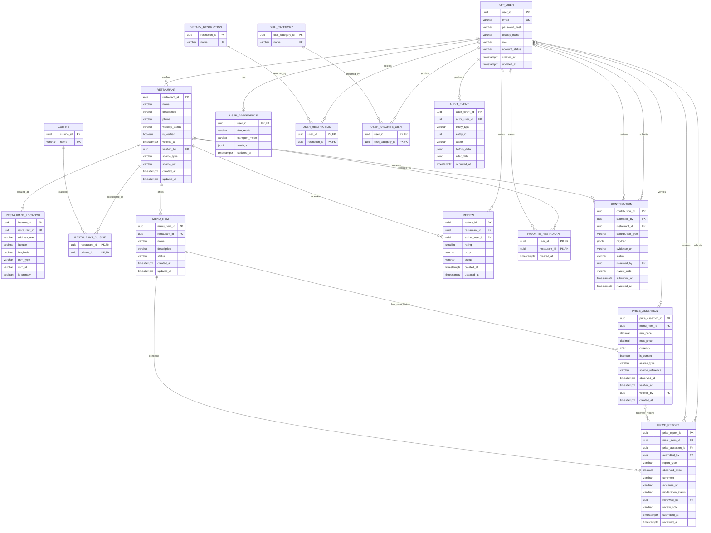

# ERD — Mua Gì Đây

ERD này mô hình hóa dữ liệu nghiệp vụ bền vững. Các service có thể sở hữu bảng/schema riêng; quan hệ trên sơ đồ thể hiện quan hệ logic và khóa tham chiếu ở tầng dữ liệu, không có nghĩa các microservice được phép truy cập trực tiếp database của nhau.



## 1. Ý nghĩa và ràng buộc quan trọng

- `RESTAURANT.status`: `PENDING`, `PUBLISHED`, `REJECTED`, `SUSPENDED`. Chỉ `PUBLISHED` xuất hiện trong tìm kiếm công khai.
- `RESTAURANT_LOCATION` tách riêng để cho phép một quán có nhiều địa điểm/chi nhánh; tọa độ dùng kiểu decimal hoặc kiểu spatial như PostGIS `geography(Point, 4326)`. Nếu mỗi quán chỉ có một địa chỉ trong MVP, vẫn giữ bảng riêng để không phải đổi mô hình khi thêm chi nhánh.
- OSM ID chỉ là tham chiếu nguồn (`osm_type` + `osm_id`), không dùng làm khóa chính. Quán cần ID nội bộ ổn định vì nguồn ngoài có thể đổi hoặc bản ghi có thể được gộp.
- `MENU_ITEM` giữ danh tính món; `PRICE_ASSERTION` lưu các lần/nguồn khẳng định giá để bảo toàn lịch sử. Giá hiện hành được chọn theo chính sách freshness/trạng thái, không ghi đè mất lịch sử.
- `PRICE_ASSERTION.status`: `UNVERIFIED`, `COMMUNITY_REPORTED`, `ADMIN_VERIFIED`, `STALE`. Không có giá thì không tạo assertion và API trả `NO_PRICE`.
- `PRICE_REPORT.report_type`: ví dụ `CONFIRM`, `INCORRECT`, `NEW_PRICE`. Một report là bằng chứng/ý kiến, không đồng nghĩa giá đã xác minh. Admin verification ghi `verified_by`, `verified_at`, nguồn và event audit.
- `PRICE_REPORT` có cả `price_assertion_id` nullable (báo cáo về khẳng định giá cụ thể) và `menu_item_id` (món được báo). Nên đặt `price_assertion_id` nullable để khách vẫn báo giá mới khi chưa có giá hiện hành.
- `CONTRIBUTION.contribution_type`: `NEW_RESTAURANT`, `RESTAURANT_CORRECTION`, `MENU_CORRECTION`, `PRICE_CORRECTION`, `CLOSED_REPORT`. Trường dữ liệu đề xuất có thể chuyển thành JSON có schema/version hoặc được chuẩn hóa thành bảng con khi nghiệp vụ ổn định.
- `USER_PREFERENCE` dành cho dữ liệu đồng bộ của tài khoản. Sở thích Guest được lưu trong trình duyệt (localStorage/IndexedDB), không có row ở server đến khi người dùng chọn đồng bộ/đăng nhập.
- `AUDIT_EVENT.entity_id` là khóa đa hình nên không thể tạo FK đơn giản đến nhiều bảng. Cần kiểm tra tham chiếu ở tầng ứng dụng hoặc dùng bảng audit theo service; giữ append-only để không sửa lịch sử kiểm duyệt.

## 2. Ràng buộc dữ liệu nên triển khai

```sql
CHECK (latitude BETWEEN -90 AND 90)
CHECK (longitude BETWEEN -180 AND 180)
CHECK (min_price >= 0 AND max_price >= min_price)
CHECK (rating BETWEEN 1 AND 5)
UNIQUE (osm_type, osm_id) -- chỉ khi cả hai giá trị không null
UNIQUE (user_id, restaurant_id) -- favorite restaurant
UNIQUE (user_id, restriction_id) -- user restriction
UNIQUE (user_id, dish_category_id) -- favorite dish
```

Thêm index cho `RESTAURANT(status)`, `MENU_ITEM(restaurant_id)`, `PRICE_ASSERTION(menu_item_id, status, observed_at)`, `REVIEW(restaurant_id, status, created_at)` và `CONTRIBUTION(status, submitted_at)`. Truy vấn quanh tọa độ nên dùng spatial index (PostGIS GiST) thay vì tự quét toàn bộ tọa độ khi dữ liệu tăng.

## 3. Phân vùng dữ liệu theo service (logic ownership)

| Service sở hữu | Dữ liệu logic |
|---|---|
| Auth/User Service | `APP_USER` và credential/role (credential nên tách khỏi hồ sơ người dùng). |
| Catalog/Restaurant Service | `RESTAURANT`, `RESTAURANT_LOCATION`, `CUISINE`, `RESTAURANT_CUISINE`, `MENU_ITEM`, `PRICE_ASSERTION`. |
| Contribution/Verification Service | `CONTRIBUTION`, `PRICE_REPORT`, hàng đợi kiểm duyệt và audit nghiệp vụ. |
| Review Service | `REVIEW`. |
| User Preference Service | `USER_PREFERENCE`, `USER_RESTRICTION`, `USER_FAVORITE_DISH`, `FAVORITE_RESTAURANT`. |
| Geo Service | Tích hợp provider; không cần sở hữu catalog quán nếu chỉ geocode/tính tuyến. |
| Context/Weather Service | Cache/context thời tiết; thường không cần quan hệ FK tới User hoặc Restaurant. |

Trong kiến trúc microservice thực sự, mỗi service là chủ sở hữu dữ liệu của mình. Service khác gọi API/event thay vì join trực tiếp bảng qua database dùng chung. ERD trên là **logical domain ERD** cho toàn hệ thống; triển khai có thể tách thành các physical ERD/schema theo service.

## 4. Câu trả lời ngắn khi vấn đáp

**ERD là gì?** ERD mô tả dữ liệu cần lưu, thực thể, thuộc tính, khóa chính/khóa ngoại và lực lượng quan hệ. ERD không mô tả thứ tự xử lý request; đó là vai trò của use case/sequence/activity diagram.

**Vì sao tách `MENU_ITEM` và `PRICE_ASSERTION`?** Một món có thể đổi giá theo thời gian và có nhiều nguồn khẳng định. Tách lịch sử giá khỏi danh tính món giúp truy vết nguồn, thời điểm, trạng thái xác minh và không mất dữ liệu cũ.

**Vì sao Guest personalization không có trong ERD server?** Guest lưu trên storage của browser nên chưa có bản ghi phía server. Chỉ khi đăng nhập và chọn đồng bộ, Preference Service mới lưu các preference gắn `user_id`.

**Vì sao OSM không nằm như một bảng quán duy nhất?** OSM là nguồn/provider ngoài; dữ liệu được đồng bộ/tham chiếu bằng `source_type/source_ref` hoặc OSM ID, còn khóa chính và trạng thái công khai thuộc catalog của ứng dụng.

**Giá cộng đồng có phải verified không?** Không. `PRICE_REPORT` lưu ý kiến/bằng chứng; `PRICE_ASSERTION.status` chỉ chuyển sang `ADMIN_VERIFIED` sau quy trình xác minh có người, nguồn và thời điểm. Cộng đồng có thể tạo trạng thái `COMMUNITY_REPORTED` riêng.

**Microservice có dùng chung database không?** Mỗi service sở hữu dữ liệu của mình. Sơ đồ tổng thể là logical ERD; trong triển khai, tách database/schema theo service và giao tiếp qua API/event để giảm coupling.

**Use case là gì và khác ERD thế nào?** Use case mô tả mục tiêu của actor và tương tác với hệ thống, gồm điều kiện trước/sau, luồng chính và ngoại lệ. ERD mô tả cấu trúc dữ liệu. Ví dụ UC “Gửi báo cáo giá” tạo bản ghi `PRICE_REPORT`; UC “Admin xác minh giá” cập nhật một `PRICE_ASSERTION` và thêm `AUDIT_EVENT`.

**Primary, supporting và offstage actor là gì?** Primary actor khởi tạo use case để đạt mục tiêu; supporting actor cung cấp dịch vụ giúp luồng hoàn tất; offstage actor có lợi ích hoặc chịu ảnh hưởng nhưng không trực tiếp tương tác. Đây là vai trò theo từng use case, không phải nhãn cố định của một người/hệ thống.

**SOA/microservice architecture của nhóm hoạt động ra sao?** Frontend gọi API Gateway/BFF; gateway xác thực request và định tuyến/tổng hợp API từ các service nghiệp vụ. NLP phân tích câu tìm kiếm; Restaurant Search đọc catalog đã công khai; Geo tích hợp provider bản đồ/geocoding/routing; Weather lấy thời tiết; Review/Contribution xử lý review và báo cáo; Preference lưu sở thích tài khoản. Service nên sở hữu dữ liệu của mình, giao tiếp qua API đồng bộ cho truy vấn cần phản hồi ngay và event/message cho quy trình bất đồng bộ như kiểm duyệt, thông báo, audit. Không nên để Gateway chứa nghiệp vụ cốt lõi hoặc để service truy cập trực tiếp database của service khác.

**Vì sao dùng microservice cho đồ án?** Để thể hiện phân chia theo bounded context, hợp đồng API và triển khai độc lập. Tuy vậy, microservice tăng chi phí vận hành (mạng, lỗi từng phần, auth, logging, deployment và eventual consistency); với MVP nhỏ, có thể triển khai dạng modular monolith trước nhưng giữ ranh giới module/API rõ, rồi tách service khi có lý do thực tế.

**Điểm cần sửa trước khi bảo vệ kiến trúc hiện tại:** tài liệu phân công cũ mô tả feedback xác nhận giá là tự chuyển sang “Đã xác minh”. Điều đó mâu thuẫn với quy tắc mới. Nên sửa thành tạo `PRICE_REPORT`/`COMMUNITY_REPORTED`; chỉ Admin hoặc quy trình xác minh được định nghĩa rõ mới chuyển assertion sang `ADMIN_VERIFIED`. Ngoài ra, đừng gọi hệ thống là microservices đã hoàn chỉnh nếu Gateway và các service 4003–4006 mới là kế hoạch/chưa có source triển khai.
