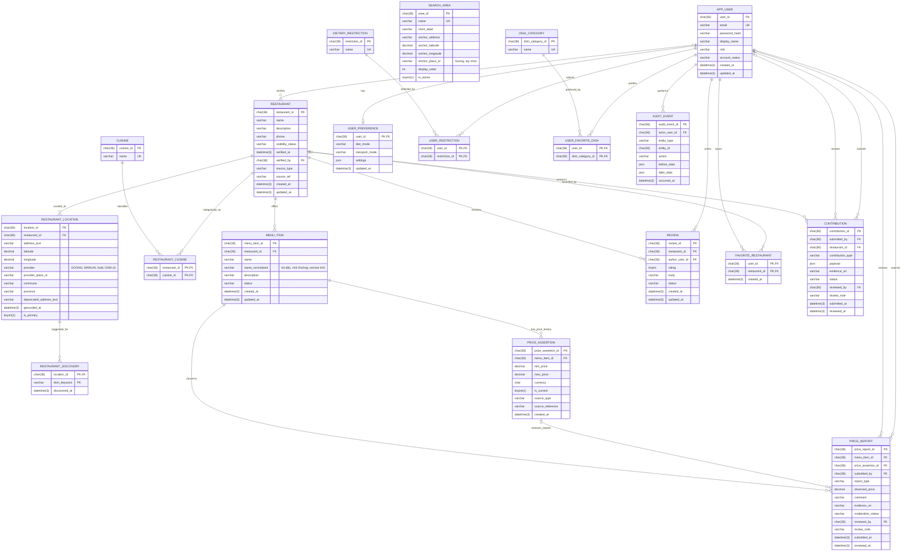

# ERD — Mua Gì Đây

ERD này mô hình hóa dữ liệu nghiệp vụ bền vững và được thiết kế cho **MySQL 8.0.16 trở lên** (InnoDB, `utf8mb4`). Kiểu dữ liệu trong sơ đồ theo MySQL: `char(36)` là UUID do service sinh, `datetime(3)` lưu giờ UTC, `tinyint(1)` là boolean, `json` là JSON. Xem mục 2 để biết cách triển khai. Các service có thể sở hữu bảng/schema riêng; quan hệ trên sơ đồ thể hiện quan hệ logic và khóa tham chiếu ở tầng dữ liệu, không có nghĩa các microservice được phép truy cập trực tiếp database của nhau.



## 1. Ý nghĩa và ràng buộc quan trọng

- `RESTAURANT.visibility_status`: `PENDING`, `PUBLISHED`, `REJECTED`, `SUSPENDED`, `CLOSED` (quán đóng cửa sau khi Admin duyệt `CLOSED_REPORT`). Danh sách quán có món và giá chỉ lấy `PUBLISHED`. Khu vực gợi ý địa điểm dùng liên kết `RESTAURANT_DISCOVERY` và chỉ xét quán `PENDING` hoặc `PUBLISHED`.
- Xác minh thuộc về **quán** (gồm cả giá), không thuộc về từng dòng giá. Không có cột `is_verified`: quán "Đã xác minh" khi `verified_at IS NOT NULL`, ngược lại là "Chưa xác minh". `verified_at` và `verified_by` luôn cùng null hoặc cùng có giá trị. Mỗi lần Admin duyệt một thay đổi của quán, thực đơn hoặc giá, hệ thống cập nhật lại `verified_at`, `verified_by` và ghi `AUDIT_EVENT`, để nhãn "Đã xác minh" không còn đúng khi thông tin đã đổi mà chưa ai kiểm tra lại. Quán "Chưa xác minh" vẫn được hiển thị (đã qua duyệt để `PUBLISHED`); nhãn chỉ cho biết Admin đã kiểm chứng thông tin hay chưa.
- `RESTAURANT_LOCATION` lưu một địa chỉ/chi nhánh. Địa điểm Goong dùng `formatted_address` → `address_text`, `geometry.location.lat/lng` → `latitude/longitude`, `place_id` → `provider_place_id`. `compound.commune/province` lưu phường/xã và tỉnh/thành theo địa giới mới. `deprecated_description` lưu tùy chọn ở `deprecated_address_text` và chỉ để tham chiếu.
- `provider` là nguồn của địa chỉ. `GOONG` có mã địa điểm và thời điểm tra cứu `geocoded_at`, `MANUAL` có tọa độ do Admin xác nhận, còn tham chiếu OSM cũ dùng `OSM` và mã dạng `node/…` hoặc `way/…`. Mã nội bộ vẫn là `location_id`; `RESTAURANT.source_type/source_ref` ghi nguồn tạo bản ghi quán.
- `RESTAURANT_DISCOVERY` lưu từ khóa chuẩn hóa dẫn đến một chi nhánh Goong. Khóa `(location_id, dish_keyword)` cho phép một địa điểm được tìm thấy qua nhiều từ khóa. Lấy `restaurant_id` từ chi nhánh để nhóm quán. `discovered_at` ghi thời điểm lần đầu lưu liên kết. Từ khóa chỉ phục vụ tìm lại địa điểm.
- `SEARCH_AREA` là danh sách khu vực được chọn khi tìm quán. Mỗi dòng có một địa chỉ mốc và một cặp tọa độ. Admin có thể sửa mốc, đặt thứ tự hoặc ẩn khu vực. `anchor_place_id` có giá trị khi chọn mốc từ Goong. GPS, ngân sách và bán kính chỉ thuộc truy vấn hiện tại. Gợi ý lưu tọa độ chi nhánh để tính lại khoảng cách theo tâm tìm mới.
- `SEARCH_AREA` đứng riêng trong ERD. Một quán có thể nằm trong bán kính của nhiều mốc. Kết quả được tính theo tọa độ và bán kính tại thời điểm tìm, nên không có khóa ngoại giữa `SEARCH_AREA` và `RESTAURANT_LOCATION`.
- `MENU_ITEM` giữ danh tính món; `PRICE_ASSERTION` lưu các lần ghi nhận giá để bảo toàn lịch sử. Giá hiện hành là dòng có `is_current = true`, mỗi món tối đa một dòng; món không có dòng `is_current = true` thì API trả `NO_PRICE`. Gỡ giá sai chỉ đặt `is_current = false`, không xóa lịch sử.
- `PRICE_ASSERTION` không có `status`, `verified_at`, `verified_by` hay `observed_at`. Mốc thời gian của một mức giá là `created_at`, tức thời điểm Admin duyệt (hoặc thời điểm nhập dữ liệu đối với giá import ban đầu). UI nên ghi "cập nhật ngày …" theo mốc này, không phải ngày người dùng nhìn thấy giá.
- `PRICE_REPORT.report_type`: `WRONG_PRICE` (báo giá đang hiển thị sai, có `price_assertion_id`) và `MISSING_PRICE` (bổ sung giá cho món chưa có giá, `price_assertion_id` null). `moderation_status`: `PENDING`, `APPROVED`, `REJECTED`. Một report chỉ là bằng chứng/ý kiến, không làm đổi giá và không làm quán thành "Đã xác minh". `PRICE_REPORT` không có `observed_at`: khi Admin duyệt, `reviewed_at` là ngày áp dụng mức giá mới (cũng là `created_at` của `PRICE_ASSERTION` được tạo ra).
- `PRICE_REPORT.price_assertion_id` nullable (báo cáo về khẳng định giá cụ thể) và `menu_item_id` bắt buộc (món được báo); nếu `price_assertion_id` có giá trị thì phải thuộc đúng `menu_item_id`. `submitted_by` bắt buộc (NOT NULL, FK tới `APP_USER`): không có báo giá ẩn danh. Chỉ người dùng đã đăng nhập với `account_status = ACTIVE` mới gửi được, kể cả khi món chưa có giá hiện hành (`MISSING_PRICE`). Guest không có bản ghi `APP_USER` nên không gửi được; frontend khóa nút gửi chỉ để dễ dùng, còn backend vẫn phải từ chối request không có phiên hợp lệ. `submitted_by` do service lấy từ danh tính đã xác thực, không nhận từ nội dung request. Tài khoản bị khóa sau đó thì báo cáo cũ vẫn giữ để truy vết (khóa bằng `account_status`, không xóa `APP_USER`).
- `CONTRIBUTION.contribution_type`: `NEW_RESTAURANT`, `RESTAURANT_CORRECTION`, `MENU_CORRECTION`, `CLOSED_REPORT`. Đề xuất giá cho món đã có trong thực đơn đi theo `PRICE_REPORT`, không có loại `PRICE_CORRECTION` riêng; `MENU_CORRECTION` dùng để thêm/sửa món (kèm giá tham khảo tùy chọn). Nội dung đề xuất nằm trong `payload` (kiểu `JSON`, có schema và version, xem mục 4). `CONTRIBUTION.submitted_by` cũng bắt buộc theo cùng quy tắc với `PRICE_REPORT.submitted_by`.
- `USER_PREFERENCE` dành cho dữ liệu đồng bộ của tài khoản. Sở thích Guest được lưu trong trình duyệt (localStorage/IndexedDB), không có row ở server đến khi người dùng chọn đồng bộ/đăng nhập.
- `AUDIT_EVENT.entity_id` là khóa đa hình nên không thể tạo FK đơn giản đến nhiều bảng. Cần kiểm tra tham chiếu ở tầng ứng dụng hoặc dùng bảng audit theo service; giữ append-only để không sửa lịch sử kiểm duyệt.

## 2. Ràng buộc dữ liệu và triển khai trên MySQL

Yêu cầu: MySQL 8.0.16+ (bản đầu tiên thực thi `CHECK`), engine InnoDB, charset `utf8mb4`.

**Quy ước chung**

- **ID:** `CHAR(36)` chứa UUID do service sinh (không dùng `AUTO_INCREMENT`, để ID không lộ thứ tự và không đụng nhau khi tách service). Có thể đổi sang `BINARY(16)` nếu cần tiết kiệm chỗ.
- **Thời gian:** `DATETIME(3)` lưu giờ UTC. Đặt `time_zone = '+00:00'` cho kết nối (với `mysql2`: `timezone: 'Z'`). Không dùng `TIMESTAMP` vì giới hạn năm 2038.
- **Boolean:** `TINYINT(1)` (`BOOLEAN` là bí danh), giá trị 0 hoặc 1.
- **Collation:** đặt mặc định `utf8mb4_0900_as_ci` (phân biệt dấu, không phân biệt hoa thường). Các cột `UNIQUE` như `cuisine.name` hay `email` sẽ không coi "bún" và "bùn" là một.
- **Giá:** `DECIMAL(12,0)` vì VND không có phần lẻ.

**Thay thế các tính năng riêng của PostgreSQL**

| Thiết kế ban đầu (PostgreSQL) | Cách làm trên MySQL |
|---|---|
| `UNIQUE ... WHERE is_current` / `WHERE is_primary` (partial index) | Cột sinh `STORED` có giá trị khi cờ bằng 1 và `NULL` khi bằng 0, rồi đặt `UNIQUE` lên cột đó (MySQL cho phép nhiều `NULL`). |
| `geography geom` + `GiST` + `ST_DWithin` | Lưu `latitude`, `longitude` (`DECIMAL(10,7)`), lọc thô bằng khung bao quanh (index `(latitude, longitude)`), rồi tính khoảng cách bằng `ST_Distance_Sphere`. |
| `pg_trgm` + `unaccent` | Cột `MENU_ITEM.name_normalized` do service tính (bỏ dấu, `đ` thành `d`, chữ thường), tìm bằng `LOCATE`. |
| `jsonb` | `JSON`. MySQL chỉ bảo đảm JSON hợp lệ. |
| `timestamptz` | `DATETIME(3)` giờ UTC. |
| `uuid` | `CHAR(36)`. |
| `UNIQUE (provider, provider_place_id)` | Giữ nguyên. MySQL cho phép nhiều dòng có `provider_place_id` là `NULL`. |

**Ràng buộc chính**

```sql
CHECK (latitude BETWEEN -90 AND 90)
CHECK (longitude BETWEEN -180 AND 180)
CHECK (min_price >= 0 AND max_price >= min_price)
CHECK (rating BETWEEN 1 AND 5)
-- PRICE_REPORT.submitted_by, CONTRIBUTION.submitted_by, REVIEW.author_user_id:
-- NOT NULL + FOREIGN KEY (...) REFERENCES app_user (user_id) ON DELETE RESTRICT
CHECK ((verified_at IS NULL) = (verified_by IS NULL))   -- RESTAURANT
CHECK (JSON_TYPE(payload) = 'OBJECT')                   -- CONTRIBUTION
UNIQUE (user_id, restaurant_id)                         -- FAVORITE_RESTAURANT
UNIQUE (user_id, restriction_id)                        -- USER_RESTRICTION
UNIQUE (user_id, dish_category_id)                      -- USER_FAVORITE_DISH
```

Lưu ý: MySQL không cho cột có `CHECK` dùng trong khóa ngoại với `ON UPDATE/DELETE CASCADE` hoặc `SET NULL`. Mọi khóa ngoại trong ERD dùng `RESTRICT` (mặc định) nên không vướng.

Thêm index cho `RESTAURANT(visibility_status)`, `MENU_ITEM(restaurant_id)`, `MENU_ITEM(name_normalized)`, `PRICE_ASSERTION(menu_item_id, created_at)` (lịch sử giá), `REVIEW(restaurant_id, status, created_at)` và `CONTRIBUTION(status, submitted_at)`.

### Giá hiện hành: mỗi món tối đa một dòng `is_current`

```sql
CREATE TABLE price_assertion (
  price_assertion_id   CHAR(36)      NOT NULL,
  menu_item_id         CHAR(36)      NOT NULL,
  min_price            DECIMAL(12,0) NOT NULL,
  max_price            DECIMAL(12,0) NOT NULL,
  currency             CHAR(3)       NOT NULL DEFAULT 'VND',
  is_current           TINYINT(1)    NOT NULL DEFAULT 0,
  source_type          VARCHAR(30)   NOT NULL,
  source_reference     VARCHAR(255)  NULL,
  created_at           DATETIME(3)   NOT NULL,
  -- NULL khi không phải giá hiện hành, nên UNIQUE chỉ ràng buộc các dòng is_current = 1
  current_menu_item_id CHAR(36) GENERATED ALWAYS AS (IF(is_current = 1, menu_item_id, NULL)) STORED,
  PRIMARY KEY (price_assertion_id),
  CONSTRAINT price_assertion_menu_item_fk FOREIGN KEY (menu_item_id) REFERENCES menu_item (menu_item_id) ON DELETE RESTRICT,
  CONSTRAINT price_assertion_range_ck CHECK (min_price >= 0 AND max_price >= min_price),
  UNIQUE KEY price_assertion_current_uq (current_menu_item_id),
  KEY price_assertion_history_ix (menu_item_id, created_at)
);
```

Khi Admin duyệt giá mới, service chạy trong một transaction: đặt dòng cũ `is_current = 0`, rồi thêm dòng mới `is_current = 1`. Nếu làm sai thứ tự, ràng buộc `UNIQUE` sẽ từ chối.

### Vị trí quán trong MySQL

Giữ đúng thứ tự **kinh độ, vĩ độ** trong `POINT(longitude, latitude)` của MySQL. Goong nhận tọa độ dạng **vĩ độ, kinh độ** khi gọi API.

```sql
CREATE TABLE restaurant_location (
  location_id             CHAR(36)      NOT NULL,
  restaurant_id           CHAR(36)      NOT NULL,
  address_text            VARCHAR(500)  NOT NULL,
  latitude                DECIMAL(10,7) NOT NULL,
  longitude               DECIMAL(10,7) NOT NULL,
  provider                VARCHAR(10)   NOT NULL,
  provider_place_id       VARCHAR(512)  NULL,
  commune                 VARCHAR(100)  NULL,
  province                VARCHAR(100)  NULL,
  deprecated_address_text VARCHAR(500)  NULL,
  geocoded_at             DATETIME(3)   NULL,
  is_primary              TINYINT(1)    NOT NULL DEFAULT 0,
  primary_restaurant_id   CHAR(36) GENERATED ALWAYS AS (IF(is_primary = 1, restaurant_id, NULL)) STORED,
  PRIMARY KEY (location_id),
  CONSTRAINT restaurant_location_restaurant_fk FOREIGN KEY (restaurant_id) REFERENCES restaurant (restaurant_id) ON DELETE RESTRICT,
  CONSTRAINT restaurant_location_lat_ck CHECK (latitude BETWEEN -90 AND 90),
  CONSTRAINT restaurant_location_lng_ck CHECK (longitude BETWEEN -180 AND 180),
  CONSTRAINT restaurant_location_provider_ck CHECK (
    (provider = 'GOONG'  AND NULLIF(TRIM(provider_place_id), '') IS NOT NULL AND geocoded_at IS NOT NULL)
    OR (provider = 'MANUAL' AND provider_place_id IS NULL)
    OR (provider = 'OSM'    AND NULLIF(TRIM(provider_place_id), '') IS NOT NULL)
  ),
  UNIQUE KEY restaurant_location_provider_place_uq (provider, provider_place_id),
  UNIQUE KEY restaurant_location_primary_uq (primary_restaurant_id),
  KEY restaurant_location_coord_ix (latitude, longitude)
);
```

Ví dụ chọn chi nhánh gần nhất trong bán kính cho mỗi quán công khai. Tâm tìm là `@lat`, `@lng` và bán kính `@radius_m` tính bằng mét. Ghép thêm điều kiện món và giá trên cùng một món khi chạy tìm kiếm catalog.

```sql
WITH distances AS (
  SELECT l.restaurant_id, l.location_id,
         ST_Distance_Sphere(POINT(l.longitude, l.latitude), POINT(@lng, @lat), 6371000) AS distance_m
  FROM restaurant_location l
  JOIN restaurant r ON r.restaurant_id = l.restaurant_id AND r.visibility_status = 'PUBLISHED'
), ranked AS (
  SELECT restaurant_id, location_id, distance_m,
         ROW_NUMBER() OVER (PARTITION BY restaurant_id ORDER BY distance_m, location_id) AS branch_rank
  FROM distances
  WHERE distance_m <= @radius_m
)
SELECT restaurant_id, location_id, distance_m
FROM ranked
WHERE branch_rank = 1;
```

Bán kính Trái Đất `6371000` khớp với Haversine của frontend mock (`R = 6371` km). Nếu thêm khung lọc sơ bộ để tối ưu, khung phải bao trọn bán kính. `is_primary` dùng cho địa chỉ mặc định của hồ sơ quán.

Nếu nâng cấp DB cũ, chép `osm_type/osm_id` sang `provider='OSM'`, `provider_place_id='type/id'` trước khi bỏ hai cột cũ. Địa chỉ thủ công dùng `MANUAL`. Mock tính bằng JavaScript và chuyển bản ghi cũ khi đọc localStorage. Tra cứu Goong lỗi hoặc chưa có tọa độ hợp lệ thì đề xuất vẫn có thể nằm trong hàng chờ. Khi công khai, Admin phải chọn kết quả Goong hoặc xác nhận đủ hai tọa độ thủ công.

### Tìm theo tên món có dấu hoặc không dấu

Service tính `name_normalized` khi tạo hoặc sửa món (bỏ dấu, `đ` thành `d`, chữ thường, gộp khoảng trắng) và dùng cùng hàm đó để chuẩn hóa từ khóa. Cách này không phụ thuộc collation của MySQL.

```sql
-- ? = ' pho bo ' (từ khóa đã chuẩn hóa, có khoảng trắng hai đầu để khớp theo từ)
SELECT menu_item_id, restaurant_id, name
FROM menu_item
WHERE status = 'ACTIVE'
  AND LOCATE(?, CONCAT(' ', name_normalized, ' ')) > 0;
```

Dùng `LOCATE` thay cho `LIKE` để không phải escape ký tự `%` và `_` trong từ khóa người dùng.

### Lưu và tìm lại gợi ý địa điểm

```sql
CREATE TABLE restaurant_discovery (
  location_id   CHAR(36)     NOT NULL,
  dish_keyword  VARCHAR(100) NOT NULL,
  discovered_at DATETIME(3)  NOT NULL,
  PRIMARY KEY (location_id, dish_keyword),
  KEY restaurant_discovery_keyword_ix (dish_keyword, location_id),
  CONSTRAINT restaurant_discovery_location_fk
    FOREIGN KEY (location_id) REFERENCES restaurant_location (location_id) ON DELETE RESTRICT
);
```

Khi catalog trả 0 kết quả, truy vấn bảng này theo từ khóa đã chuẩn hóa, nối với chi nhánh và quán, lọc trạng thái và bán kính của lượt tìm. Chỉ gọi Geo Service tìm mới khi cũng không có gợi ý đã lưu. Ví dụ, `bún bò` và `bun bo` dùng chung khóa `bun bo`.

Khi ghi kết quả Goong, Catalog tạo quán `PENDING`, chi nhánh và liên kết từ khóa trong cùng giao dịch. Khóa duy nhất `(provider, provider_place_id)` nhận diện chi nhánh từ nguồn ngoài và ánh xạ về `restaurant_id` nội bộ ổn định. Nếu hai request gặp cùng địa điểm, giao dịch gặp khóa trùng phải rollback phần tạo quán rồi tái sử dụng chi nhánh của giao dịch đã ghi thành công. Giữ nguyên thông tin kiểm duyệt, menu và giá của bản ghi đã có. Bản ghi nhập tay chỉ được hợp nhất khi xác nhận trùng địa điểm.

### Danh sách khu vực tìm kiếm

```sql
CREATE TABLE search_area (
  area_id          CHAR(36)      NOT NULL,
  name             VARCHAR(100)  NOT NULL,
  short_label      VARCHAR(40)   NOT NULL,
  anchor_address   VARCHAR(500)  NOT NULL,
  anchor_latitude  DECIMAL(10,7) NOT NULL,
  anchor_longitude DECIMAL(10,7) NOT NULL,
  anchor_place_id  VARCHAR(512)  NULL,
  display_order    INT           NOT NULL DEFAULT 0,
  is_active        TINYINT(1)    NOT NULL DEFAULT 1,
  PRIMARY KEY (area_id),
  UNIQUE KEY search_area_name_uq (name),
  CONSTRAINT search_area_lat_ck CHECK (anchor_latitude BETWEEN -90 AND 90),
  CONSTRAINT search_area_lng_ck CHECK (anchor_longitude BETWEEN -180 AND 180),
  CONSTRAINT search_area_order_ck CHECK (display_order BETWEEN 0 AND 10000)
);
```

Geo Service cấp ID khi tạo và duy trì ít nhất một khu vực đang hoạt động (kiểm tra ở tầng service, MySQL không ràng buộc được điều này bằng `CHECK`). Khi chọn mốc để truy vấn, dùng `anchor_latitude` và `anchor_longitude` làm `@lat`, `@lng` trong truy vấn ở trên, còn bán kính km nhân 1000 để thành mét. Mock lưu bảng trong localStorage và dùng Haversine cho cùng luồng nghiệp vụ.

## 3. Phân vùng dữ liệu theo service (logic ownership)

Phân vùng dưới đây khớp 1-1 với `backend/api-gateway/` (`4000`) và 7 service nghiệp vụ (`4001`–`4007`) trong [kiến trúc SOA](SOA_ARCHITECTURE.md) và [bảng phân công](TEAM_ASSIGNMENT.md):

| Service sở hữu | Port | Dữ liệu logic (19 bảng trong ERD) |
|---|---|---|
| `api-gateway` | `4000` | Không sở hữu bảng nghiệp vụ (định tuyến, tổng hợp BFF, Auth Guard kiểm tra token và chuyển tiếp danh tính). |
| `context-weather-service` | `4001` | Không sở hữu bảng cốt lõi (cache ngữ cảnh thời tiết & gợi ý món theo khung giờ). |
| `nlp-conversation-service` | `4002` | Không sở hữu bảng cốt lõi (stateless: chuẩn hóa từ khóa món ăn & gợi ý có sẵn). |
| `restaurant-search-service` (Catalog & Search) | `4003` | `RESTAURANT`, `RESTAURANT_LOCATION`, `RESTAURANT_DISCOVERY`, `CUISINE`, `RESTAURANT_CUISINE`, `MENU_ITEM`, `PRICE_ASSERTION`. |
| `routing-geo-service` (Geo & Routing) | `4004` | `SEARCH_AREA` và tích hợp Goong V2. (`RESTAURANT_LOCATION` vẫn thuộc `restaurant-search-service`). |
| `feedback-review-service` (Feedback & Moderation) | `4005` | `REVIEW`, `PRICE_REPORT`, `CONTRIBUTION`, `AUDIT_EVENT` (hàng đợi kiểm duyệt và nhật ký nghiệp vụ). |
| `user-preference-service` (Preference) | `4006` | `USER_PREFERENCE`, `DIETARY_RESTRICTION`, `USER_RESTRICTION`, `DISH_CATEGORY`, `USER_FAVORITE_DISH`, `FAVORITE_RESTAURANT`. |
| `auth-service` (Auth & User) | `4007` | `APP_USER` (tài khoản, credential, vai trò `USER`/`ADMIN`, `account_status`). |

Khi Admin duyệt một `CONTRIBUTION` hoặc `PRICE_REPORT`, `feedback-review-service` (`4005`) không ghi thẳng vào bảng của `restaurant-search-service` (`4003`): nó gọi API của `restaurant-search-service` để tạo/cập nhật `RESTAURANT`, `RESTAURANT_LOCATION`, `MENU_ITEM`, `PRICE_ASSERTION` và làm mới `RESTAURANT.verified_at`/`verified_by`, đồng thời ghi `AUDIT_EVENT` (hoặc mỗi service ghi audit phần việc của mình khi tách DB vật lý).

Trong kiến trúc microservice thực sự, mỗi service là chủ sở hữu dữ liệu của mình. Service khác gọi API/event thay vì join trực tiếp bảng qua database dùng chung. ERD trên là **logical domain ERD** cho toàn hệ thống; triển khai có thể tách thành các physical ERD/schema theo service.

## 4. `CONTRIBUTION.payload` (JSON)

Thay vì nhiều cột `proposed_name`, `proposed_address`, `proposed_price`…, mỗi đề xuất lưu trọn trong một cột `payload`; hình dạng phụ thuộc `contribution_type`. `evidence_uri` vẫn là cột riêng (nullable) và `restaurant_id` là NULL với `NEW_RESTAURANT` cho đến khi Admin duyệt.

**Schema version 1** (khớp với frontend mock hiện tại). Mọi payload có `schema_version`.

| `contribution_type` | Trường bắt buộc | Trường tùy chọn |
|---|---|---|
| `NEW_RESTAURANT` | `name`, `address` | `location`, `phone`, `openUntil`, `dishName`, `dishPrice`, `note` |
| `RESTAURANT_CORRECTION` | ít nhất một trong `name`, `address`, `phone`, `openUntil`, `note` | `location` |
| `MENU_CORRECTION` | ít nhất một trong `dishName`, `dishPrice`, `note` | `dishDescription` |
| `CLOSED_REPORT` | không có | `note` |

```json
{
  "schema_version": 1,
  "name": "Quán minh họa",
  "address": "2/31 Ngô Gia Khảm, Bồ Đề, Hà Nội",
  "location": {
    "provider": "GOONG",
    "provider_place_id": "<place_id>",
    "address_text": "2/31 Ngô Gia Khảm, Bồ Đề, Hà Nội",
    "latitude": 21.048178407,
    "longitude": 105.87687658,
    "commune": "Bồ Đề",
    "province": "Hà Nội",
    "deprecated_address_text": "31 Ngõ 2 Ngô Gia Khảm, Ngọc Lâm, Long Biên, Hà Nội",
    "geocoded_at": "2026-11-26T05:00:00Z"
  }
}
```

Cách làm:

1. **Mỗi type có một schema JSON** (có `schema_version`) và backend kiểm tra trước khi lưu: kiểu dữ liệu, độ dài chuỗi, `dishPrice >= 0`, tọa độ trong phạm vi hợp lệ, trường bắt buộc theo bảng trên. MySQL chỉ bảo đảm `payload` là JSON hợp lệ (cột kiểu `JSON`) và là một object (`CHECK (JSON_TYPE(payload) = 'OBJECT')`); kiểm tra chi tiết bên trong nằm ở service. Có thể bổ sung `JSON_SCHEMA_VALID` từ MySQL 8.0.17 nếu muốn.
2. **Khi Admin duyệt**, service đọc payload (Admin có thể sửa giá trị trước khi duyệt) và ghi vào bảng thật (`RESTAURANT`, `RESTAURANT_LOCATION`, `MENU_ITEM`, `PRICE_ASSERTION`) trong một transaction logic, đồng thời làm mới `RESTAURANT.verified_at`/`verified_by` và ghi `AUDIT_EVENT` kèm before/after.
3. **Payload giữ nguyên làm lịch sử** của đề xuất, kể cả khi bị từ chối. Giá trị Admin đã sửa được ghi ở `AUDIT_EVENT`, không ghi đè payload.
4. **Các id đặt trong payload** (nếu có, ví dụ id món) không có FK nên phải kiểm tra tồn tại tại thời điểm duyệt.
5. `location` là trường bổ sung của schema v1. Bản ghi cũ có cặp `latitude`/`longitude` ở cấp ngoài vẫn dùng được khi địa chỉ được duyệt trùng với địa chỉ đề xuất. Khi Admin đổi địa chỉ, cần xác nhận tọa độ ứng với địa chỉ mới.

Ranh giới với `PRICE_REPORT`: người dùng muốn báo giá của một món đã có trong thực đơn thì dùng `PRICE_REPORT`. `MENU_CORRECTION` chỉ dành cho thêm/sửa món (giá kèm theo chỉ là giá tham khảo, vẫn do Admin duyệt).

## 5. Câu trả lời ngắn khi vấn đáp

**ERD là gì?** ERD mô tả dữ liệu cần lưu, thực thể, thuộc tính, khóa chính/khóa ngoại và lực lượng quan hệ. ERD không mô tả thứ tự xử lý request; đó là vai trò của use case/sequence/activity diagram.

**Vì sao tách `MENU_ITEM` và `PRICE_ASSERTION`?** Một món có thể đổi giá theo thời gian và có nhiều nguồn khẳng định. Tách lịch sử giá khỏi danh tính món giúp truy vết nguồn, thời điểm ghi nhận và không mất dữ liệu cũ.

**Vì sao Guest personalization không có trong ERD server?** Guest lưu trên storage của browser nên chưa có bản ghi phía server. Chỉ khi đăng nhập và chọn đồng bộ, Preference Service mới lưu các preference gắn `user_id`.

**Goong đi vào ERD ở đâu?** Địa chỉ, tọa độ và mã nơi chốn được lưu ở `RESTAURANT_LOCATION`. Kết quả từ nhánh tìm bổ sung còn có từ khóa lưu trong `RESTAURANT_DISCOVERY` để lần sau tìm lại từ MySQL. Catalog quản lý mã nội bộ và trạng thái công khai của quán. [Goong Place Detail V2](https://help.goong.io/kb/rest-api-v2/place-detail-rest-api-v2/place-detail-place-detail-v2/)

**Vì sao thêm `SEARCH_AREA`?** Một địa danh như “Quận 4” biểu thị một vùng, còn phép tìm trong bán kính cần một điểm. `SEARCH_AREA` lưu điểm mốc do Admin chọn. Khi khách chia sẻ vị trí thiết bị, lượt tìm dùng tọa độ thiết bị làm tâm.

**Giá cộng đồng có phải verified không?** Không. `PRICE_REPORT` chỉ lưu ý kiến/bằng chứng ở trạng thái `PENDING`. Chỉ khi Admin duyệt, giá mới được ghi thành một `PRICE_ASSERTION` mới (`is_current`) và quán được cập nhật `verified_at`/`verified_by`. Hệ thống không có trạng thái xác minh riêng cho từng giá: nhãn "Đã xác minh" thuộc về quán, gồm cả giá, và mọi thay đổi đều do Admin duyệt.

**Khách chưa đăng nhập có báo giá được không?** Không. `PRICE_REPORT.submitted_by` bắt buộc và trỏ tới `APP_USER`, nên Guest chỉ tìm kiếm và xem quán; muốn báo giá phải đăng nhập. Lý do: Admin cần biết ai gửi để truy vết và chống spam, và `AUDIT_EVENT` cần có tác nhân. Frontend khóa nút gửi, backend kiểm tra lại phiên đăng nhập.

**Vì sao chọn MySQL, và tìm quán theo bán kính thế nào?** Nhóm dùng MySQL cho các service. MySQL không có PostGIS nên khoảng cách tính bằng `latitude`/`longitude` kèm `ST_Distance_Sphere`, và khung bao quanh được index để lọc trước. Với số lượng quán của đồ án, cách này đủ nhanh. Nếu dữ liệu lớn hơn nhiều thì mới cần chuyển sang cột không gian có `SPATIAL INDEX` hoặc PostGIS.

**Microservice có dùng chung database không?** Mỗi service sở hữu dữ liệu của mình. Sơ đồ tổng thể là logical ERD; trong triển khai, tách database/schema theo service và giao tiếp qua API/event để giảm coupling.

**Use case là gì và khác ERD thế nào?** Use case mô tả mục tiêu của actor và tương tác với hệ thống, gồm điều kiện trước/sau, luồng chính và ngoại lệ. ERD mô tả cấu trúc dữ liệu. Ví dụ UC “Gửi báo cáo giá” tạo bản ghi `PRICE_REPORT`; UC “Admin xử lý báo cáo giá” tạo `PRICE_ASSERTION` mới, làm mới `RESTAURANT.verified_at` và thêm `AUDIT_EVENT`.

**Primary, supporting và offstage actor là gì?** Primary actor khởi tạo use case để đạt mục tiêu; supporting actor cung cấp dịch vụ giúp luồng hoàn tất; offstage actor có lợi ích hoặc chịu ảnh hưởng nhưng không trực tiếp tương tác. Đây là vai trò theo từng use case, không phải nhãn cố định của một người/hệ thống.

**SOA/microservice architecture của nhóm hoạt động ra sao?** Frontend gọi `api-gateway` (`4000`); gateway thực hiện Auth Guard và định tuyến/tổng hợp API từ 7 service nghiệp vụ (`4001`–`4007`). `auth-service` (`4007`) quản lý `APP_USER`, đăng nhập/đăng ký và cấp phiên; `nlp-conversation-service` (`4002`) chuẩn hóa từ khóa tìm kiếm; `context-weather-service` (`4001`) lấy thời tiết và gợi ý món; `restaurant-search-service` (`4003`) quản lý catalog và lọc quán công khai; `routing-geo-service` (`4004`) quản lý `SEARCH_AREA` và tích hợp Goong V2; `feedback-review-service` (`4005`) xử lý review, báo cáo giá, đóng góp và audit kiểm duyệt; `user-preference-service` (`4006`) quản lý sở thích và quán yêu thích. Mỗi service sở hữu dữ liệu của mình, giao tiếp qua API đồng bộ cho truy vấn cần phản hồi ngay và event/message cho quy trình bất đồng bộ như kiểm duyệt, thông báo, audit. Không nên để Gateway chứa nghiệp vụ cốt lõi hoặc để service truy cập trực tiếp database của service khác.

**Vì sao dùng microservice cho đồ án?** Để thể hiện phân chia theo bounded context, hợp đồng API và triển khai độc lập. Tuy vậy, microservice tăng chi phí vận hành (mạng, lỗi từng phần, auth, logging, deployment và eventual consistency); với MVP nhỏ, có thể triển khai dạng modular monolith trước nhưng giữ ranh giới module/API rõ, rồi tách service khi có lý do thực tế.

**Điểm cần lưu ý trước khi bảo vệ kiến trúc hiện tại:** feedback của người dùng chỉ tạo `PRICE_REPORT` ở trạng thái `PENDING` và không bao giờ tự đổi giá hay nhãn xác minh; chỉ Admin duyệt mới làm đổi dữ liệu và cập nhật `RESTAURANT.verified_at`. Ngoài ra, đừng gọi hệ thống là microservices đã hoàn chỉnh nếu Gateway và các service 4003–4007 mới là kế hoạch/chưa có source triển khai.
