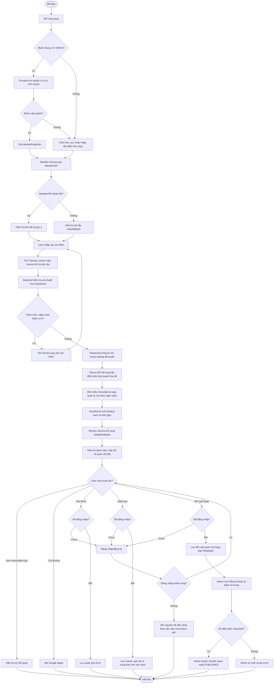

# Đặc tả Use Case — Mua Gì Đây

**Phạm vi:** Web app gợi ý và tìm quán ăn theo món, ngân sách, vị trí; xem menu/đánh giá; người dùng đóng góp quán; admin kiểm duyệt trước khi quán được công khai.

## 1. Quy ước actor trong đặc tả

- **Primary actor:** vai trò khởi phát use case để đạt mục tiêu của mình.
- **Supporting actor:** hệ thống hoặc dịch vụ bên ngoài tham gia để use case hoàn thành.
- **Offstage actor:** bên có lợi ích hoặc chịu ảnh hưởng bởi kết quả, nhưng không trực tiếp thao tác trong luồng đó.
- Một actor có thể ở vai trò khác nhau trong use case khác nhau. Ví dụ Admin là primary actor khi duyệt đề xuất, nhưng là offstage actor khi User gửi đề xuất.
- Gemini chỉ phân tích ý định và trả dữ liệu có cấu trúc; không tự tạo kết quả quán, xác nhận giá hoặc duyệt nội dung.

## 2. Tác nhân

| Actor                | Mô tả                                                                                                                                              |
| -------------------- | ---------------------------------------------------------------------------------------------------------------------------------------------------- |
| Khách (Guest)       | Dùng tìm kiếm, xem kết quả và bản đồ mà không cần tài khoản.                                                                           |
| Người dùng (User) | Khách đã đăng nhập; có thể lưu yêu thích, sở thích, gửi đánh giá và đề xuất quán.                                              |
| Admin                | Người kiểm duyệt đề xuất quán và xử lý yêu cầu xác minh dữ liệu. Tài khoản admin do hệ thống cấp, không đăng ký công khai. |
| WeatherAPI           | Nhà cung cấp thời tiết hiện tại.                                                                                                               |
| Gemini API           | Phân tích câu tự nhiên thành intent/slots có cấu trúc khi parser luật cần hỗ trợ.                                                       |
| Google Places API    | Tìm địa điểm/quán quanh vị trí; không phải nguồn xác minh menu/giá của app.                                                            |
| Google Maps          | Mở địa điểm hoặc lộ trình cho người dùng.                                                                                                 |
| Dịch vụ nền SOA   | API Gateway và các service NLP, weather, restaurant search, geo/routing, review và user preference.                                               |

## 3. Sơ đồ hoạt động chính

### Ranh giới tin cậy

1. Frontend không được tự quyết định quyền Admin; backend xác thực vai trò ở từng endpoint.
2. Kết quả Gemini phải qua schema validation và kiểm tra miền giá trị trước khi gọi search service.
3. Google Places có thể gợi ý địa điểm, nhưng chỉ dữ liệu catalog được duyệt mới xuất hiện như quán đã xác minh trong app.
4. Review/giá người dùng gửi không tự động biến thành “đã xác minh”; admin hoặc chính sách xác minh riêng phải cập nhật trạng thái.

## 4. Danh mục Use Case

| ID    | Use Case                                       | Primary actor          |
| ----- | ---------------------------------------------- | ---------------------- |
| UC-01 | Tạo tài khoản/đăng nhập                  | Khách / Người dùng |
| UC-02 | Cung cấp vị trí tìm kiếm                  | Khách / Người dùng |
| UC-03 | Xem thời tiết và gợi ý món               | Khách / Người dùng |
| UC-04 | Tìm quán bằng hội thoại                   | Khách / Người dùng |
| UC-05 | Điều chỉnh kết quả tìm kiếm             | Khách / Người dùng |
| UC-06 | Xem chi tiết quán và chỉ đường          | Khách / Người dùng |
| UC-07 | Quản lý yêu thích và sở thích           | Người dùng          |
| UC-08 | Gửi đánh giá/xác nhận giá               | Người dùng          |
| UC-09 | Đề xuất quán mới                          | Người dùng          |
| UC-10 | Kiểm duyệt đề xuất quán                  | Admin                  |
| UC-11 | Xác minh/cập nhật thông tin và giá quán | Admin                  |

## 5. Đặc tả Use Case

### UC-01 — Tạo tài khoản/đăng nhập

| Thuộc tính       | Đặc tả                                                                                                                                                                                                                                        |
| ------------------ | ------------------------------------------------------------------------------------------------------------------------------------------------------------------------------------------------------------------------------------------------ |
| Mục tiêu         | Cho phép người dùng truy cập các thao tác cần danh tính như yêu thích đồng bộ, đánh giá và đề xuất quán. Tìm kiếm công khai không yêu cầu đăng nhập.                                                             |
| Primary actor      | Khách khi đăng ký; Người dùng khi đăng nhập.                                                                                                                                                                                           |
| Supporting actors  | Frontend; API Gateway; dịch vụ xác thực/tài khoản; kho dữ liệu người dùng; dịch vụ gửi email/OTP nếu được triển khai.                                                                                                         |
| Offstage actors    | Admin; chủ quán; người dùng khác bị ảnh hưởng bởi nội dung đóng góp.                                                                                                                                                              |
| Tiền điều kiện | Đăng ký: email chưa được dùng. Đăng nhập: tài khoản đã tồn tại và không bị khóa.                                                                                                                                            |
| Kích hoạt        | Người dùng chọn Đăng ký hoặc Đăng nhập khi thực hiện chức năng cần tài khoản.                                                                                                                                                  |
| Luồng chính      | 1) Nhập thông tin. 2) Frontend gửi qua Gateway. 3) Backend kiểm tra định dạng và chính sách mật khẩu. 4) Backend xác thực hoặc tạo tài khoản, lưu mật khẩu dạng hash. 5) Trả phiên/token và trạng thái người dùng. |
| Ngoại lệ         | Email sai/trùng, mật khẩu không hợp lệ, thông tin sai hoặc tài khoản bị khóa: báo lỗi phù hợp, không tạo phiên.                                                                                                               |
| Hậu điều kiện  | Thành công: người dùng có phiên hợp lệ. Thất bại: không đổi dữ liệu tài khoản.                                                                                                                                                 |

### UC-02 — Cung cấp vị trí tìm kiếm

| Thuộc tính       | Đặc tả                                                                                                                                                                                                                                                                                |
| ------------------ | ---------------------------------------------------------------------------------------------------------------------------------------------------------------------------------------------------------------------------------------------------------------------------------------- |
| Mục tiêu         | Chọn vị trí trung tâm để tìm quán và lấy ngữ cảnh thời tiết.                                                                                                                                                                                                               |
| Primary actor      | Khách hoặc Người dùng.                                                                                                                                                                                                                                                              |
| Supporting actors  | Trình duyệt Geolocation API; Frontend; API Gateway; Geo Service; Weather Service; WeatherAPI.                                                                                                                                                                                          |
| Offstage actors    | Người đi cùng; chủ các quán nằm trong vùng tìm kiếm.                                                                                                                                                                                                                          |
| Tiền điều kiện | Người dùng có thể dùng vị trí hiện tại hoặc nhập/chọn địa chỉ thủ công. Geolocation cần được người dùng cho phép.                                                                                                                                              |
| Kích hoạt        | Chọn “Vị trí hiện tại”, chọn khu vực hoặc nhập địa chỉ.                                                                                                                                                                                                                    |
| Luồng chính      | 1) Nếu chọn vị trí thiết bị, trình duyệt hỏi quyền. 2) Khi được cấp, frontend nhận tọa độ. 3) Nếu chọn thủ công, frontend gửi địa chỉ/khu vực. 4) Backend chuẩn hóa vị trí và dùng làm tâm tìm kiếm. 5) Giao diện hiển thị khu vực đang dùng. |
| Ngoại lệ         | Từ chối quyền, timeout hoặc không định vị được: giữ lựa chọn cũ và cho nhập/chọn thủ công. Địa chỉ không tìm thấy: yêu cầu chọn lại.                                                                                                                       |
| Hậu điều kiện  | Thành công: vị trí hiện tại của phiên tìm kiếm được cập nhật. Không tự lưu lâu dài nếu người dùng chưa chọn lưu làm mặc định.                                                                                                                             |

### UC-03 — Xem thời tiết và gợi ý món

| Thuộc tính       | Đặc tả                                                                                                                                                                                                                                 |
| ------------------ | ----------------------------------------------------------------------------------------------------------------------------------------------------------------------------------------------------------------------------------------- |
| Mục tiêu         | Hiển thị thời tiết hiện tại và câu gợi ý món theo thời tiết/thời gian.                                                                                                                                                      |
| Primary actor      | Khách hoặc Người dùng.                                                                                                                                                                                                               |
| Supporting actors  | Frontend; API Gateway; Context-Weather Service; WeatherAPI.                                                                                                                                                                               |
| Offstage actors    | Người dùng xem gợi ý; chủ quán có món được gợi ý.                                                                                                                                                                           |
| Tiền điều kiện | Có vị trí đã chọn hoặc dùng vị trí mặc định.                                                                                                                                                                                 |
| Kích hoạt        | Mở màn hình chính hoặc đổi vị trí.                                                                                                                                                                                               |
| Luồng chính      | 1) Frontend yêu cầu context. 2) Weather Service gọi provider với tọa độ/địa điểm. 3) Chuẩn hóa nhiệt độ, điều kiện, giờ địa phương. 4) Chọn gợi ý món theo quy tắc của app. 5) Trả dữ liệu cho frontend. |
| Ngoại lệ         | Provider lỗi/hết quota: dùng dữ liệu mẫu và đánh dấu nguồn fallback; không hiển thị dữ liệu mẫu như số đo trực tiếp.                                                                                                |
| Hậu điều kiện  | Không thay đổi dữ liệu quán hoặc tài khoản.                                                                                                                                                                                      |

### UC-04 — Tìm quán bằng hội thoại

| Thuộc tính       | Đặc tả                                                                                                                                                                                                                                                                                                                                                                                                                                                                                                      |
| ------------------ | -------------------------------------------------------------------------------------------------------------------------------------------------------------------------------------------------------------------------------------------------------------------------------------------------------------------------------------------------------------------------------------------------------------------------------------------------------------------------------------------------------------- |
| Mục tiêu         | Hiểu yêu cầu tìm món và trả danh sách quán phù hợp món, ngân sách, vị trí, bán kính.                                                                                                                                                                                                                                                                                                                                                                                                         |
| Primary actor      | Khách hoặc Người dùng.                                                                                                                                                                                                                                                                                                                                                                                                                                                                                    |
| Supporting actors  | Frontend; API Gateway; NLP Conversation Service; Gemini API khi cần; Restaurant Search Service; catalog nội bộ; Google Places API; Geo Service; Review Service.                                                                                                                                                                                                                                                                                                                                             |
| Offstage actors    | Người đi ăn cùng; chủ quán; Admin chịu trách nhiệm chất lượng catalog.                                                                                                                                                                                                                                                                                                                                                                                                                            |
| Tiền điều kiện | Có vị trí tìm kiếm hoặc có thể được hỏi bổ sung; request đạt giới hạn kích thước.                                                                                                                                                                                                                                                                                                                                                                                                          |
| Kích hoạt        | Nhập câu như “30k cà phê sữa”, “phở bò” hoặc “cháo sườn quanh đây”.                                                                                                                                                                                                                                                                                                                                                                                                                        |
| Luồng chính      | 1) Frontend gửi câu và state hiện tại. 2) NLP parser áp dụng luật; nếu cần, Gemini trả intent/slots theo schema. 3) Backend kiểm tra enum, ngân sách, bán kính và số người. 4) Nếu thiếu slot bắt buộc, bot hỏi lại. 5) Khi đủ thông tin, Restaurant Search tìm catalog đã duyệt và có thể bổ sung địa điểm từ Places. 6) Lọc món/giá theo dữ liệu app. 7) Geo và Review bổ sung khoảng cách/đánh giá. 8) Trả kết quả có nguồn dữ liệu rõ ràng. |
| Ngoại lệ         | Câu không hiểu: hỏi lại hoặc đưa ví dụ. Gemini lỗi: fallback parser luật. Không có quán/menu đạt ngân sách: trả trạng thái rỗng và gợi ý nới ngân sách/bán kính; không bịa kết quả.                                                                                                                                                                                                                                                                                         |
| Hậu điều kiện  | Trả kết quả hoặc câu hỏi bổ sung; không tự ghi review hay thay đổi catalog.                                                                                                                                                                                                                                                                                                                                                                                                                         |

### UC-05 — Điều chỉnh kết quả tìm kiếm

| Thuộc tính       | Đặc tả                                                                                                                                                                                 |
| ------------------ | ----------------------------------------------------------------------------------------------------------------------------------------------------------------------------------------- |
| Mục tiêu         | Thu hẹp/nới tiêu chí sau lượt tìm đầu.                                                                                                                                           |
| Primary actor      | Khách hoặc Người dùng.                                                                                                                                                               |
| Supporting actors  | Frontend; NLP Conversation Service; API Gateway; Restaurant Search Service; Geo Service.                                                                                                  |
| Offstage actors    | Người đi cùng; chủ các quán được xếp hạng.                                                                                                                                    |
| Tiền điều kiện | Có state tìm kiếm hiện tại.                                                                                                                                                          |
| Kích hoạt        | Nhập “rẻ hơn”, “gần hơn”, “đi 2 người” hoặc đổi chip giá/bán kính/sắp xếp.                                                                                          |
| Luồng chính      | 1) Gửi câu và state hiện tại. 2) Parser xác định trường cần đổi. 3) Backend cập nhật đúng trường, giữ các slot còn lại. 4) Tìm lại và sắp xếp theo yêu cầu. |
| Ngoại lệ         | Không có state trước đó: yêu cầu món/vị trí còn thiếu. Giá/bán kính ngoài giới hạn: yêu cầu nhập lại.                                                              |
| Hậu điều kiện  | State tìm kiếm mới được phản ánh trên bộ lọc và kết quả.                                                                                                                    |

### UC-06 — Xem chi tiết quán và chỉ đường

| Thuộc tính       | Đặc tả                                                                                                                                                                                                                                                                      |
| ------------------ | ------------------------------------------------------------------------------------------------------------------------------------------------------------------------------------------------------------------------------------------------------------------------------ |
| Mục tiêu         | Xem menu, giá, địa chỉ, rating và mở chỉ đường.                                                                                                                                                                                                                      |
| Primary actor      | Khách hoặc Người dùng.                                                                                                                                                                                                                                                    |
| Supporting actors  | Frontend; Restaurant Search Service; Review Service; Geo/Route Service; Google Maps.                                                                                                                                                                                           |
| Offstage actors    | Chủ quán; người đánh giá; người đi cùng.                                                                                                                                                                                                                            |
| Tiền điều kiện | Quán xuất hiện trong kết quả hoặc được mở bằng mã/place ID hợp lệ.                                                                                                                                                                                               |
| Kích hoạt        | Chọn thẻ quán, Menu/Feedback hoặc Chỉ đường.                                                                                                                                                                                                                           |
| Luồng chính      | 1) Yêu cầu dữ liệu chi tiết. 2) Backend trả menu và dữ liệu nội bộ; dữ liệu Places phải kèm attribution theo chính sách. 3) Geo tính khoảng cách/ước tính tuyến. 4) Khi chọn chỉ đường, mở Google Maps với đích và phương tiện phù hợp. |
| Ngoại lệ         | Quán ngừng hoạt động/không còn tồn tại: hiển thị trạng thái cập nhật hoặc bỏ khỏi kết quả. Không có tuyến: vẫn hiển thị địa chỉ và link bản đồ.                                                                                               |
| Hậu điều kiện  | Chỉ đọc dữ liệu; không cập nhật catalog.                                                                                                                                                                                                                               |

### UC-07 — Quản lý yêu thích và sở thích

| Thuộc tính       | Đặc tả                                                                                                                                                   |
| ------------------ | ----------------------------------------------------------------------------------------------------------------------------------------------------------- |
| Mục tiêu         | Lưu quán yêu thích, khẩu vị, món tránh và phương tiện di chuyển.                                                                               |
| Primary actor      | Người dùng.                                                                                                                                              |
| Supporting actors  | Frontend; API Gateway; User Preference Service; kho dữ liệu người dùng.                                                                                |
| Offstage actors    | Người đi cùng; chủ quán được lưu yêu thích.                                                                                                     |
| Tiền điều kiện | Người dùng đã đăng nhập để đồng bộ giữa thiết bị; app có thể cho khách lưu tạm cục bộ.                                               |
| Kích hoạt        | Nhấn tim hoặc lưu thay đổi trong cá nhân hóa.                                                                                                       |
| Luồng chính      | 1) Người dùng thay đổi lựa chọn. 2) Frontend gửi preference/favorite. 3) Backend xác thực chủ sở hữu và lưu. 4) Trả trạng thái đã lưu. |
| Ngoại lệ         | Chưa đăng nhập: yêu cầu đăng nhập hoặc lưu tạm trên thiết bị. API lỗi: giữ lựa chọn tạm và báo chưa đồng bộ.                      |
| Hậu điều kiện  | Dữ liệu chỉ gắn với chính tài khoản.                                                                                                                |

### UC-08 — Gửi đánh giá/xác nhận giá

| Thuộc tính       | Đặc tả                                                                                                                                                                                                                                                                                              |
| ------------------ | ------------------------------------------------------------------------------------------------------------------------------------------------------------------------------------------------------------------------------------------------------------------------------------------------------ |
| Mục tiêu         | Chia sẻ trải nghiệm, rating, bình luận và giá quan sát được.                                                                                                                                                                                                                                |
| Primary actor      | Người dùng đã đăng nhập.                                                                                                                                                                                                                                                                       |
| Supporting actors  | Frontend; API Gateway; Feedback-Review Service; kho dữ liệu review; moderation/anti-spam controls.                                                                                                                                                                                                   |
| Offstage actors    | Chủ quán; người dùng khác đọc review; Admin xử lý báo cáo.                                                                                                                                                                                                                                 |
| Tiền điều kiện | Người dùng đăng nhập; quán đang tồn tại; dữ liệu nhập qua validation.                                                                                                                                                                                                                     |
| Kích hoạt        | Gửi form review/feedback.                                                                                                                                                                                                                                                                             |
| Luồng chính      | 1) Nhập rating/comment/giá và thời điểm quan sát nếu có. 2) Backend kiểm tra phạm vi rating, độ dài và trạng thái quán. 3) Lưu review. 4) Giá mới ở trạng thái `PENDING` hoặc `USER_REPORTED`, không tự gắn nhãn admin-verified. 5) Trả mã review và trạng thái. |
| Ngoại lệ         | Thiếu rating, nội dung không hợp lệ, gửi trùng hoặc quán không tồn tại: từ chối và nêu trường cần sửa.                                                                                                                                                                             |
| Hậu điều kiện  | Review được lưu hoặc không đổi dữ liệu; trạng thái xác minh giá độc lập với rating.                                                                                                                                                                                                  |

### UC-09 — Đề xuất quán mới

| Thuộc tính       | Đặc tả                                                                                                                                                                                                                                                                                      |
| ------------------ | ---------------------------------------------------------------------------------------------------------------------------------------------------------------------------------------------------------------------------------------------------------------------------------------------- |
| Mục tiêu         | Cho người dùng đề xuất quán chưa có trong catalog.                                                                                                                                                                                                                                    |
| Primary actor      | Người dùng đã đăng nhập.                                                                                                                                                                                                                                                               |
| Supporting actors  | Frontend; API Gateway; Restaurant Contribution/Catalog Service; Places API để kiểm tra gợi ý/trùng; kho dữ liệu submission.                                                                                                                                                            |
| Offstage actors    | Admin; chủ quán; người dùng khác có thể tìm quán sau khi duyệt.                                                                                                                                                                                                                     |
| Tiền điều kiện | Đã đăng nhập; có tên và vị trí tối thiểu; đồng ý gửi thông tin để kiểm duyệt.                                                                                                                                                                                             |
| Kích hoạt        | Chọn “Thêm quán” và gửi form.                                                                                                                                                                                                                                                           |
| Luồng chính      | 1) Nhập tên, địa chỉ/tọa độ, loại món, giá/menu tham khảo, bằng chứng. 2) Backend kiểm tra bắt buộc và tìm bản ghi gần trùng. 3) Lưu submission `PENDING`. 4) Báo người gửi mã và trạng thái chờ duyệt. 5) Không đưa quán vào public search lúc này. |
| Ngoại lệ         | Thiếu dữ liệu/trùng nghi vấn: yêu cầu bổ sung hoặc liên kết bản ghi hiện có. Upload lỗi: giữ draft nếu hỗ trợ.                                                                                                                                                              |
| Hậu điều kiện  | Submission có người gửi, timestamp, evidence reference và trạng thái kiểm duyệt.                                                                                                                                                                                                      |

### UC-10 — Kiểm duyệt đề xuất quán

| Thuộc tính       | Đặc tả                                                                                                                                                                                                                                                                                                                                                                                                |
| ------------------ | -------------------------------------------------------------------------------------------------------------------------------------------------------------------------------------------------------------------------------------------------------------------------------------------------------------------------------------------------------------------------------------------------------- |
| Mục tiêu         | Quyết định đề xuất có đủ căn cứ để được công khai hay không.                                                                                                                                                                                                                                                                                                                           |
| Primary actor      | Admin đã xác thực và được cấp quyền moderation.                                                                                                                                                                                                                                                                                                                                                |
| Supporting actors  | Admin UI; API Gateway; Identity/Authorization; Catalog Service; Places API; audit log/notification service.                                                                                                                                                                                                                                                                                              |
| Offstage actors    | Người gửi đề xuất; chủ quán; người dùng tìm kiếm.                                                                                                                                                                                                                                                                                                                                           |
| Tiền điều kiện | Admin có quyền; submission đang `PENDING`; chưa được admin khác xử lý.                                                                                                                                                                                                                                                                                                                       |
| Kích hoạt        | Admin mở hàng chờ kiểm duyệt.                                                                                                                                                                                                                                                                                                                                                                       |
| Luồng chính      | 1) Xem dữ liệu và bằng chứng. 2) Kiểm tra trùng, địa chỉ, loại hình và nguồn xác nhận. 3) Chọn duyệt hoặc từ chối, nhập ghi chú/lý do. 4) Backend kiểm tra quyền và trạng thái hiện tại. 5) Ghi reviewer/time/decision vào audit log. 6) Duyệt thì tạo/cập nhật quán `PUBLISHED`; từ chối thì giữ submission với `REJECTED`. 7) Thông báo người gửi. |
| Ngoại lệ         | Không đủ căn cứ: yêu cầu bổ sung/chuyển `NEEDS_INFO`. Đã bị xử lý: tải trạng thái mới, không ghi đè. Admin không có quyền: trả 403.                                                                                                                                                                                                                                           |
| Hậu điều kiện  | Quán chỉ công khai khi quyết định duyệt được lưu thành công; mọi quyết định truy vết được.                                                                                                                                                                                                                                                                                          |

### UC-11 — Xác minh/cập nhật thông tin và giá quán

| Thuộc tính       | Đặc tả                                                                                                                                                                                                                                                                   |
| ------------------ | --------------------------------------------------------------------------------------------------------------------------------------------------------------------------------------------------------------------------------------------------------------------------- |
| Mục tiêu         | Cập nhật giá/menu và gắn trạng thái xác minh với bằng chứng, người xác minh, thời điểm.                                                                                                                                                                    |
| Primary actor      | Admin đã xác thực và có quyền quản lý catalog.                                                                                                                                                                                                                     |
| Supporting actors  | Admin UI; API Gateway; Catalog Service; Feedback-Review Service; audit log; nguồn bằng chứng (liên hệ quán, menu chính thức hoặc kiểm tra thực tế).                                                                                                             |
| Offstage actors    | Người gửi feedback; chủ quán; người dùng xem giá.                                                                                                                                                                                                                  |
| Tiền điều kiện | Quán tồn tại và admin có quyền; nguồn kiểm chứng được ghi nhận.                                                                                                                                                                                                |
| Kích hoạt        | Admin xử lý báo cáo giá sai, dữ liệu cũ hoặc yêu cầu xác minh.                                                                                                                                                                                                  |
| Luồng chính      | 1) Mở dữ liệu hiện tại và lịch sử báo giá. 2) So sánh với bằng chứng. 3) Cập nhật giá/menu hoặc giữ nguyên. 4) Ghi `verifiedBy`, `verifiedAt`, `verificationSource` và trạng thái. 5) Ghi audit log và thông báo bên liên quan nếu cần. |
| Ngoại lệ         | Bằng chứng không đủ: không gắn verified; chuyển `NEEDS_INFO` hoặc giữ `UNVERIFIED`. Xung đột cập nhật: tải lại dữ liệu rồi xác nhận.                                                                                                               |
| Hậu điều kiện  | Chỉ thông tin có nguồn và thời gian xác minh hợp lệ mới mang nhãn “Đã xác minh”.                                                                                                                                                                            |

## 6. Quy tắc nghiệp vụ xuyên use case

| Mã   | Quy tắc                                                                                                |
| ----- | ------------------------------------------------------------------------------------------------------- |
| BR-01 | Khách có thể tìm kiếm và xem kết quả mà không cần đăng nhập.                              |
| BR-02 | Chỉ User đăng nhập mới gửi review, lưu đồng bộ yêu thích hoặc đề xuất quán.            |
| BR-03 | Chỉ Admin được phép duyệt/từ chối submission hoặc gắn xác minh admin.                        |
| BR-04 | Quán `PENDING`/`REJECTED` không xuất hiện trong public search.                                  |
| BR-05 | Không suy diễn giá món từ Google Places; giá phải có nguồn trong catalog/menu app.             |
| BR-06 | AI chỉ trích xuất intent/slots; backend xác thực, search service quyết định dữ liệu trả về. |
| BR-07 | Mọi thay đổi moderation và xác minh phải có audit trail.                                         |
| BR-08 | Việc từ chối quyền vị trí không chặn tìm kiếm; cho phép nhập địa điểm thủ công.       |

## 7. Ghi chú phạm vi triển khai

Tài liệu mô tả mục tiêu sản phẩm, không khẳng định các service Auth, Catalog Contribution, Gemini, Google Places, Prometheus hay Grafana đã được triển khai. Với phiên bản đồ án đầu tiên, có thể mô phỏng dữ liệu nhưng cần giữ các trạng thái và quy tắc trên để nâng cấp không phải đổi lại luồng nghiệp vụ.
