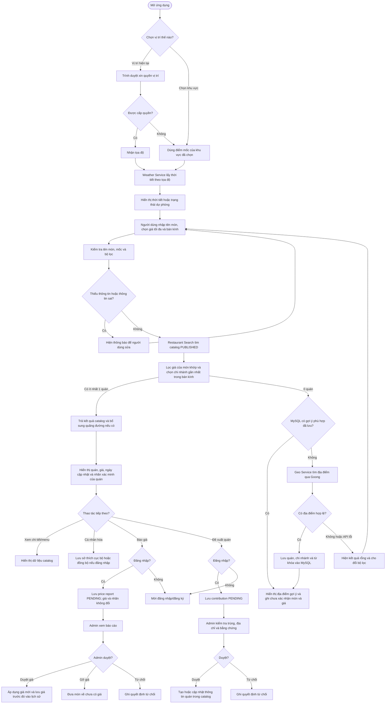

# Đặc tả Use Case — Mua Gì Đây

**Phiên bản:** A1–A7 và B1–B5, đồng bộ với [ERD MySQL](ERD.md).

**Phạm vi:** ứng dụng web tìm quán ăn theo món, vị trí, bán kính, ngân sách và đánh giá; cho phép đóng góp dữ liệu quán/giá để admin kiểm duyệt.

## 1. Mục tiêu và nguyên tắc

1. Khách có thể tìm kiếm, xem quán và dùng cá nhân hóa cơ bản mà không cần đăng nhập.
2. Goong V2 xử lý gợi ý địa chỉ, lấy tọa độ và tính đường đi. Trình duyệt cung cấp tọa độ thiết bị khi được cấp quyền.
3. Catalog của Mua Gì Đây cung cấp quán, món và giá để tìm kiếm. Khi MySQL không có quán phù hợp hay gợi ý đã lưu, hệ thống tra cứu địa điểm qua Goong và lưu kết quả hợp lệ cho lần sau.
4. Giá hiện hành lấy từ lần cập nhật giá được Admin duyệt sau cùng. Hệ thống lưu các mức giá trước đó cùng nguồn và thời điểm. Nhãn “Đã xác minh” thuộc về quán và dựa vào `verified_at`.
5. Ô chat nhận tên món. Mốc, ngân sách và bán kính lấy từ các điều khiển tìm kiếm. Mục gợi ý địa điểm ghi rõ “Chưa xác nhận món và giá”.
6. Đăng nhập là tùy chọn cho trải nghiệm thông thường; yêu cầu tài khoản cho các đóng góp có trách nhiệm như review, đề xuất quán và báo cáo giá chính thức.

## 2. Quy ước actor và ba nhóm actor

- **Primary actor (tác nhân chính):** người hoặc vai trò khởi tạo use case để đạt mục tiêu.
- **Supporting actor (tác nhân hỗ trợ):** hệ thống, dịch vụ hoặc vai trò hỗ trợ hoàn tất luồng.
- **Offstage actor (tác nhân liên quan):** có lợi ích hoặc chịu tác động từ kết quả nhưng không trực tiếp thao tác trong luồng đó.
- Vai trò phụ thuộc từng use case: Admin có thể là primary actor khi duyệt quán, nhưng là offstage actor khi người dùng gửi báo cáo.

## 3. Danh sách tác nhân

| Actor | Loại | Trách nhiệm |
|---|---|---|
| Khách (Guest) | Người dùng | Tìm quán, xem kết quả/bản đồ, chọn vị trí và lưu sở thích cục bộ không cần tài khoản. |
| Người dùng có tài khoản (User) | Người dùng | Các quyền của Guest; đồng bộ sở thích/yêu thích và gửi review, báo cáo giá hoặc đề xuất quán. |
| Admin | Người dùng vận hành | Kiểm duyệt quán mới, xử lý báo cáo, xác minh và cập nhật catalog. Tài khoản do hệ thống cấp. |
| Trình duyệt Geolocation API | Hệ thống ngoài | Xin quyền và trả tọa độ thiết bị khi người dùng đồng ý. |
| Goong REST API V2 | Hệ thống ngoài | Tìm địa điểm khi DB không có dữ liệu dùng được, gợi ý và chuẩn hóa địa chỉ, đổi tọa độ thiết bị thành nhãn hiển thị, tính quãng đường và thời gian đi. |
| Meteosource | Hệ thống ngoài | Cung cấp thời tiết theo tọa độ/khu vực. |
| Gemini API (tùy chọn) | Hệ thống ngoài | Hỗ trợ phân tích câu tìm kiếm tự nhiên thành intent/slots có cấu trúc; không tự xác minh hoặc sinh quán. |
| Dịch vụ nền SOA | Hệ thống | `api-gateway` (`4000`) và 7 service: `context-weather-service` (`4001`), `nlp-conversation-service` (`4002`), `restaurant-search-service` (`4003`), `routing-geo-service` (`4004`), `feedback-review-service` (`4005`), `user-preference-service` (`4006`), `auth-service` (`4007`). |

> Google Maps có thể được mở như ứng dụng ngoài từ cửa sổ chỉ đường.

## 4. Sơ đồ hoạt động tổng quát

### Ranh giới tin cậy

- Backend phải kiểm tra quyền Admin; frontend không tự quyết định quyền truy cập.
- Nội dung do NLP/Gemini trả về phải qua schema validation, giới hạn giá trị và kiểm tra nghiệp vụ.
- Kết quả Goong cung cấp dữ liệu vị trí. Admin kiểm tra thông tin quán, món và giá trước khi công khai.
- Contribution của người dùng không tự sửa giá chính thức và không tự đưa quán mới lên public search.
- Mọi quyết định duyệt, xác minh, từ chối cần có người thực hiện, thời điểm, nguồn/bằng chứng và audit log.

## 5. Danh mục Use Case

| ID | Use Case | Primary actor | Cần đăng nhập? |
|---|---|---|---|
| UC-01 | Tạo tài khoản/đăng nhập | Guest/User | Có cho thao tác tài khoản |
| UC-02 | Chọn vị trí tìm kiếm | Guest/User | Không |
| UC-03 | Xem thời tiết và gợi ý món | Guest/User | Không |
| UC-04 | Tìm quán theo tên món và bộ lọc | Guest/User | Không |
| UC-05 | Điều chỉnh và sắp xếp kết quả | Guest/User | Không |
| UC-06 | Xem quán, menu, trạng thái giá và mở chỉ đường | Guest/User | Không |
| UC-07 | Cá nhân hóa sở thích và yêu thích | Guest/User hoặc User | Không cho lưu cục bộ; có cho đồng bộ |
| UC-08 | Gửi báo cáo giá | User | Có |
| UC-09 | Gửi đánh giá quán | User | Có |
| UC-10 | Đề xuất quán mới hoặc báo sai thông tin | User | Có |
| UC-11 | Kiểm duyệt đề xuất quán | Admin | Có, quyền Admin |
| UC-12 | Duyệt hoặc từ chối báo cáo giá | Admin | Có, quyền Admin |
| UC-13 | Quản lý mốc khu vực tìm kiếm | Admin | Có, quyền Admin |

## 6. Đặc tả Use Case

### UC-01 — Tạo tài khoản/đăng nhập

| Thuộc tính | Đặc tả |
|---|---|
| Mục tiêu | Tạo danh tính để đồng bộ dữ liệu giữa thiết bị và thực hiện đóng góp có trách nhiệm. Tìm kiếm và sở thích cơ bản vẫn dùng được khi chưa đăng nhập. |
| Primary actor | Guest khi đăng ký; User khi đăng nhập. |
| Supporting actors | Frontend, `api-gateway` (`4000`), `auth-service` (`4007`, quản lý `APP_USER`), `user-preference-service` (`4006`, đồng bộ sở thích), dịch vụ email/OTP nếu triển khai. |
| Offstage actors | Admin; người dùng khác chịu ảnh hưởng từ đóng góp. |
| Tiền điều kiện | Đăng ký: thông tin hợp lệ và chưa có tài khoản. Đăng nhập: tài khoản tồn tại, không bị khóa. |
| Kích hoạt | Chọn đăng ký/đăng nhập hoặc chọn một thao tác yêu cầu tài khoản. |
| Luồng chính | 1) Nhập thông tin. 2) Backend xác thực đầu vào. 3) Khi đăng ký, lưu mật khẩu đã hash. 4) Cấp phiên/token và trả trạng thái. 5) Nếu có sở thích cục bộ, hỏi/cho phép nhập vào tài khoản để đồng bộ. |
| Ngoại lệ | Thông tin sai, email trùng, sai mật khẩu hoặc tài khoản bị khóa: báo lỗi và không tạo phiên. |
| Hậu điều kiện | Thành công: có phiên hợp lệ. Không đăng nhập: người dùng vẫn có thể tiếp tục các chức năng công khai. |

### UC-02 — Chọn vị trí tìm kiếm

| Thuộc tính | Đặc tả |
|---|---|
| Mục tiêu | Đặt tâm tìm kiếm cho khoảng cách, bản đồ và thời tiết. |
| Primary actor | Guest hoặc User. |
| Supporting actors | Trình duyệt Geolocation API, Frontend, API Gateway, Geo Service, geocoding provider, Weather Service. |
| Offstage actors | Người đi cùng; quán nằm trong khu vực được tìm. |
| Tiền điều kiện | Có ít nhất một khu vực đang hoạt động trong `SEARCH_AREA`. |
| Kích hoạt | Chọn khu vực trong danh sách hoặc bấm “Vị trí hiện tại”. |
| Luồng chính | 1) Với khu vực, dùng tọa độ của điểm mốc cấu hình sẵn. 2) Với “Vị trí hiện tại”, trình duyệt xin quyền và trả tọa độ thiết bị. 3) Goong Reverse Geocode có thể bổ sung nhãn địa chỉ. 4) Giao diện hiện tên điểm mốc hoặc “vị trí của bạn”. |
| Ngoại lệ | Khi trình duyệt từ chối hoặc không lấy được vị trí, dùng mốc khu vực đã chọn. Khi Goong lỗi, giữ tọa độ thiết bị và hiện nhãn “vị trí của bạn”. |
| Hậu điều kiện | Truy vấn có một điểm bắt đầu. Tọa độ thiết bị chỉ lưu trong trạng thái trang. |

### UC-03 — Xem thời tiết và gợi ý món

| Thuộc tính | Đặc tả |
|---|---|
| Mục tiêu | Cho ngữ cảnh thời tiết hiện tại và gợi ý món theo thời tiết/thời gian. |
| Primary actor | Guest hoặc User. |
| Supporting actors | Frontend, API Gateway, Context-Weather Service, Meteosource. |
| Offstage actors | Quán có món được gợi ý. |
| Tiền điều kiện | Có vị trí do người dùng chọn hoặc vị trí mặc định của ứng dụng. |
| Kích hoạt | Mở trang chính hoặc đổi vị trí. |
| Luồng chính | 1) Frontend yêu cầu context. 2) Weather Service gọi provider bằng tọa độ/khu vực. 3) Chuẩn hóa nhiệt độ, điều kiện và thời điểm cập nhật. 4) Trả gợi ý món phù hợp. |
| Ngoại lệ | Provider lỗi hoặc thiếu dữ liệu: bản preview hiển thị thông tin có nhãn “Dữ liệu mẫu”. |
| Hậu điều kiện | Ngữ cảnh được hiển thị cùng nguồn/thời điểm thích hợp. |

### UC-04 — Tìm quán theo tên món và bộ lọc

| Thuộc tính | Đặc tả |
|---|---|
| Mục tiêu | Tìm quán phù hợp với món, mức giá, vị trí và bán kính. |
| Primary actor | Guest hoặc User. |
| Supporting actors | Frontend, API Gateway, NLP Service, Restaurant Search/Catalog Service, MySQL, Geo Service, Goong. |
| Offstage actors | Quán có thể xuất hiện trong kết quả; người dùng khác. |
| Tiền điều kiện | Có tên món hợp lệ, điểm bắt đầu, ngân sách tối đa mỗi người và bán kính. |
| Kích hoạt | Nhập “bún bò”, dùng GPS hoặc mốc đã chọn, đặt ngân sách tối đa 40k và bán kính 3 km rồi bấm “Tìm quán”. |
| Luồng chính | 1) Chuẩn hóa tên món. 2) Truy vấn MySQL để xét mọi chi nhánh của quán `PUBLISHED` trong bán kính đường chim bay. Giữ quán có món `ACTIVE` khớp tên và giá hiện hành trong ngân sách. 3) Trả ngay một kết quả cho mỗi quán, chọn chi nhánh gần nhất. Từ 5 quán là đủ theo ví dụ; 1–4 quán cũng trả ngay. 4) Khi có 0 quán, tra gợi ý đã lưu theo từ khóa và bán kính. 5) Nếu gợi ý đã lưu cũng trống, gọi Goong, lưu địa điểm hợp lệ cùng mã quán nội bộ và hiển thị với nhãn “Chưa xác nhận món và giá”. |
| Ngoại lệ | Đầu vào sai thì hướng dẫn sửa. Nếu Goong lỗi hoặc không có địa điểm hợp lệ, hiển thị kết quả rỗng và cho đổi bộ lọc hoặc đề xuất quán. Lỗi DB trả lỗi truy vấn. |
| Hậu điều kiện | Quán nhập mới được lưu `PENDING`. Lượt tìm lại cùng từ khóa trong bán kính bao phủ chi nhánh đã lưu dùng trực tiếp MySQL. Món, giá và nhãn xác minh của catalog giữ nguyên cho đến khi được cập nhật qua kiểm duyệt. |

### UC-05 — Điều chỉnh và sắp xếp kết quả

| Thuộc tính | Đặc tả |
|---|---|
| Mục tiêu | Thu hẹp kết quả theo khoảng cách, ngân sách, rating hoặc lựa chọn như gần nhất/rẻ nhất/đề xuất. |
| Primary actor | Guest hoặc User. |
| Supporting actors | Frontend, API Gateway, Restaurant Search Service, Geo Service, Review Service. |
| Offstage actors | Quán trong tập kết quả. |
| Tiền điều kiện | Có kết quả tìm kiếm hoặc điều kiện tìm kiếm hiện tại. |
| Kích hoạt | Đổi ngân sách, bán kính, khu vực hoặc tiêu chí sắp xếp bằng các nút chọn. |
| Luồng chính | 1) Cập nhật tiêu chí. 2) Backend kiểm tra miền giá trị. 3) Search Service chạy lại luồng UC-04 với tiêu chí mới và trả kết quả đã sắp xếp. |
| Ngoại lệ | Bán kính hoặc giá sai thì yêu cầu chọn lại. Nếu cả catalog lẫn gợi ý đều trống sau khi chạy UC-04, cho đổi điều kiện. |
| Hậu điều kiện | Bộ lọc mới áp dụng cho phiên tìm kiếm; Guest không cần đăng nhập. |

### UC-06 — Xem quán, menu, trạng thái giá và mở chỉ đường

| Thuộc tính | Đặc tả |
|---|---|
| Mục tiêu | Giúp người dùng đánh giá quán dựa trên thông tin có nguồn và xem đường đi. |
| Primary actor | Guest hoặc User. |
| Supporting actors | Frontend, Catalog Service, Review Service, Geo Service, Goong và ứng dụng bản đồ ngoài. |
| Offstage actors | Chủ quán; người đã đóng góp menu/giá. |
| Tiền điều kiện | Quán tồn tại và được phép hiển thị công khai. |
| Kích hoạt | Mở thẻ/chi tiết quán hoặc chọn “Chỉ đường”. |
| Luồng chính | 1) Hiển thị tên quán, địa chỉ của chi nhánh được chọn, menu, giá, khoảng cách và điểm đánh giá. 2) Ghi rõ khoảng cách tính từ mốc hay từ vị trí thiết bị, theo đường chim bay hay theo tuyến. 3) Khi chọn “Chỉ đường”, lấy tuyến đi từ điểm tìm đến đúng chi nhánh được chọn. 4) Người dùng có thể mở ứng dụng bản đồ ngoài. |
| Ngoại lệ | Không có menu/giá: ghi rõ “Chưa có giá” và không suy diễn. Routing/map provider lỗi: vẫn hiển thị địa chỉ để người dùng tự tra cứu. |
| Hậu điều kiện | Không thay đổi dữ liệu quán khi chỉ xem hoặc mở chỉ đường. |

### UC-07 — Cá nhân hóa sở thích và yêu thích

| Thuộc tính | Đặc tả |
|---|---|
| Mục tiêu | Lưu món thích, món cần tránh, chế độ ăn, phương tiện/ưu tiên và quán yêu thích. |
| Primary actor | Guest với lưu cục bộ; User với đồng bộ tài khoản. |
| Supporting actors | Frontend, localStorage/IndexedDB của trình duyệt; Preference Service và kho dữ liệu người dùng nếu đăng nhập. |
| Offstage actors | Quán được ưu tiên hoặc loại khỏi gợi ý. |
| Tiền điều kiện | Người dùng mở phần cá nhân hóa. Đăng nhập chỉ cần cho đồng bộ máy chủ. |
| Kích hoạt | Chọn/lưu sở thích hoặc đánh dấu yêu thích. |
| Luồng chính | 1) Người dùng chọn các tùy chọn. 2) Guest lưu trên trình duyệt hiện tại và thấy thông báo “Chỉ lưu trên thiết bị này”. 3) User có thể lưu cục bộ và đồng bộ server. 4) Gợi ý sau đó áp dụng sở thích đã lưu. 5) Khi Guest đăng nhập, có thể chọn nhập sở thích cục bộ vào tài khoản. |
| Ngoại lệ | Storage bị chặn/xóa hoặc trình duyệt ở chế độ riêng tư: báo rằng tùy chọn không lưu được, vẫn cho dùng trong phiên hiện tại. Lỗi đồng bộ: giữ bản cục bộ và báo trạng thái. |
| Hậu điều kiện | Guest: dữ liệu chỉ nằm trong storage của trình duyệt trên thiết bị đó, không đảm bảo tồn tại vĩnh viễn hay đồng bộ thiết bị. User: dữ liệu đồng bộ theo chính sách tài khoản. |

### UC-08 — Gửi báo cáo giá

| Thuộc tính | Đặc tả |
|---|---|
| Mục tiêu | Thu thập thông tin thực tế về giá món để cải thiện độ tin cậy của catalog. |
| Primary actor | User đã đăng nhập. |
| Supporting actors | Frontend, `api-gateway`, `feedback-review-service` (`PRICE_REPORT`), moderation/anti-spam. |
| Offstage actors | Admin, chủ quán và người xem giá. |
| Tiền điều kiện | Quán tồn tại; người dùng đã đăng nhập bằng tài khoản `ACTIVE` (báo cáo luôn có người gửi); báo cáo gắn với món/quán và có dữ liệu cần thiết. |
| Kích hoạt | Chọn “Giá không đúng” hoặc bổ sung giá cho món chưa có giá (kèm ảnh menu nếu có). |
| Luồng chính | 1) Chọn món. Món đang có giá tạo báo cáo `WRONG_PRICE` kèm `price_assertion_id` tại lúc gửi. Món chưa có giá tạo `MISSING_PRICE` với tham chiếu giá để trống. 2) Nhập giá đề xuất, ghi chú hoặc bằng chứng. 3) Lưu `PRICE_REPORT` với người gửi từ phiên đăng nhập và trạng thái `PENDING`. 4) Hiện trạng thái tiếp nhận. |
| Ngoại lệ | Chưa đăng nhập: frontend khóa nút gửi và mời đăng nhập; nếu request vẫn đến backend thì bị từ chối. Tài khoản không còn `ACTIVE`: từ chối. Thiếu/không hợp lệ hoặc nghi spam: yêu cầu sửa hoặc từ chối. |
| Hậu điều kiện | Báo cáo được lưu với người gửi (`submitted_by`, lấy từ phiên đăng nhập), thời điểm gửi, giá đề xuất/bằng chứng và `moderation_status = PENDING`; giá chính thức và nhãn xác minh không tự đổi. |

### UC-09 — Gửi đánh giá quán

| Thuộc tính | Đặc tả |
|---|---|
| Mục tiêu | Cho người dùng đánh giá trải nghiệm và cung cấp nhận xét hữu ích. |
| Primary actor | User đã đăng nhập. |
| Supporting actors | Frontend, API Gateway, Review Service, moderation/anti-spam. |
| Offstage actors | Chủ quán, người đọc review, Admin. |
| Tiền điều kiện | Quán đang công khai; User đăng nhập. |
| Kích hoạt | Gửi rating và nội dung đánh giá. |
| Luồng chính | 1) Nhập rating/comment. 2) Backend kiểm tra phạm vi, độ dài, spam và quy tắc nội dung. 3) Lưu review theo trạng thái kiểm duyệt phù hợp. 4) Hiển thị hoặc xếp hàng kiểm duyệt theo chính sách. |
| Ngoại lệ | Dữ liệu sai, trùng lặp hoặc vi phạm quy tắc: từ chối hoặc giữ chờ xử lý. |
| Hậu điều kiện | Review được truy vết; rating không tự xác minh giá hoặc thông tin quán. |

### UC-10 — Đề xuất quán mới hoặc báo sai thông tin

| Thuộc tính | Đặc tả |
|---|---|
| Mục tiêu | Cho người dùng đề xuất quán mới, cập nhật thông tin quán hoặc thực đơn, hoặc báo quán đóng cửa. Thay đổi riêng giá của một món đã có đi qua UC-08. |
| Primary actor | User đã đăng nhập. |
| Supporting actors | Frontend, `api-gateway`, `feedback-review-service` (`CONTRIBUTION`), `routing-geo-service` (Goong V2), kho file bằng chứng. |
| Offstage actors | Admin, chủ quán, người dùng khác. |
| Tiền điều kiện | User đăng nhập; đề xuất có thông tin tối thiểu; báo cáo sai thông tin tham chiếu quán hiện có. |
| Kích hoạt | Chọn “Thêm quán” hoặc thao tác báo cáo trên thẻ/chi tiết quán. |
| Luồng chính | 1) Nhập thông tin và loại đóng góp. 2) Khi đề xuất địa chỉ, có thể chọn gợi ý Goong để server lấy Place Detail và chuẩn hóa địa chỉ/tọa độ. 3) Lưu submission `PENDING`, kèm kết quả tra cứu nếu có. 4) Trả mã và trạng thái cho người gửi. 5) Catalog được cập nhật sau khi Admin duyệt. |
| Ngoại lệ | Goong thiếu kết quả hoặc tạm lỗi: cho nhập địa chỉ thủ công để chờ Admin xác minh. Thiếu dữ liệu bắt buộc: báo trường cần sửa. |
| Hậu điều kiện | `CONTRIBUTION` lưu người gửi, thời điểm, bằng chứng, loại yêu cầu và trạng thái. Nội dung đề xuất nằm trong `payload` kiểu JSON và có `schema_version`. |

### UC-11 — Kiểm duyệt đề xuất quán

| Thuộc tính | Đặc tả |
|---|---|
| Mục tiêu | Quyết định quán mới có đủ căn cứ để công khai hay cần bổ sung/từ chối. |
| Primary actor | Admin có quyền moderation. |
| Supporting actors | Admin UI, `api-gateway`, `feedback-review-service` (`CONTRIBUTION`, `AUDIT_EVENT`), `restaurant-search-service` (`RESTAURANT`, `RESTAURANT_LOCATION`), `routing-geo-service` (Goong V2), notification service. |
| Offstage actors | Người gửi, chủ quán, người tìm kiếm. |
| Tiền điều kiện | Admin có quyền và đề xuất đang ở trạng thái `PENDING`. |
| Kích hoạt | Admin mở hàng chờ kiểm duyệt. |
| Luồng chính | 1) Xem thông tin, bằng chứng và dấu hiệu trùng. 2) Kiểm tra địa chỉ và tọa độ cùng nguồn. 3) Nếu sửa địa chỉ, chọn lại gợi ý Goong hoặc nhập cả vĩ độ và kinh độ đã kiểm tra. 4) Backend kiểm tra quyền, trạng thái và mã địa điểm trùng. 5) Khi duyệt, tạo/cập nhật quán và địa điểm, đồng thời ghi nhật ký duyệt. |
| Ngoại lệ | Thiếu tọa độ hợp lệ hoặc chưa xác định được bản ghi khớp thì giữ đề xuất chờ duyệt. Nếu mã Goong khớp với quán hệ thống đã nhập, Admin kiểm tra và dùng lại bản ghi đó. Đề xuất đã xử lý hoặc người dùng thiếu quyền thì từ chối cập nhật. |
| Hậu điều kiện | Duyệt quán mới tạo bản ghi `PUBLISHED` hoặc cập nhật bản ghi `PENDING` đã nhập. Duyệt báo quán đóng cửa chuyển quán sang `CLOSED`. Đề xuất ghi nhận `APPROVED` hoặc `REJECTED` và quyết định có trong nhật ký. |

### UC-12 — Duyệt hoặc từ chối báo cáo giá

| Thuộc tính | Đặc tả |
|---|---|
| Mục tiêu | Kiểm tra báo cáo và quyết định mức giá hiện hành của món. |
| Primary actor | Admin có quyền quản lý catalog. |
| Supporting actors | Admin UI, `api-gateway`, `feedback-review-service` (`PRICE_REPORT`, `AUDIT_EVENT`), `restaurant-search-service` (`PRICE_ASSERTION`, `RESTAURANT`), bằng chứng từ người dùng/nguồn chính thức. |
| Offstage actors | Người báo cáo, chủ quán, người dùng xem dữ liệu. |
| Tiền điều kiện | Quán và món tồn tại, báo cáo đang `PENDING`, Admin có quyền duyệt. |
| Kích hoạt | Admin mở hàng đợi báo cáo giá. |
| Luồng chính | 1) Xem giá hiện hành, giá được tham chiếu khi gửi báo cáo và bằng chứng. 2) Duyệt mức giá đã kiểm chứng, gỡ giá về `NO_PRICE` hoặc từ chối. 3) Khi duyệt mức giá, chuyển dòng hiện hành cũ sang lịch sử và tạo dòng `PRICE_ASSERTION` hiện hành mới. Khi gỡ, bỏ cờ hiện hành khỏi dòng giá đang áp dụng. 4) Ghi người duyệt, thời điểm, ghi chú và nhật ký. Lần cập nhật giá làm mới `verified_at` và `verified_by` của quán. |
| Ngoại lệ | Báo cáo đã xử lý hoặc người thực hiện thiếu quyền thì từ chối thao tác. Nếu bằng chứng chưa đủ, Admin để `PENDING` hoặc chọn `REJECTED`; giá hiện hành và nhãn quán giữ nguyên. |
| Hậu điều kiện | Lần cập nhật thành công sau cùng quyết định giá hiện hành. Báo cáo còn `PENDING` vẫn có thể được duyệt nếu tham chiếu đúng món, kể cả khi giá lúc gửi đã chuyển sang lịch sử. |

### UC-13 — Quản lý mốc khu vực tìm kiếm

| Thuộc tính | Đặc tả |
|---|---|
| Mục tiêu | Tạo, cập nhật và ẩn khu vực cùng điểm mốc dùng cho tìm kiếm. |
| Primary actor | Admin có quyền quản trị. |
| Supporting actors | Admin UI, Geo Service, Goong V2. |
| Offstage actors | Khách và người dùng tìm quán theo khu vực. |
| Tiền điều kiện | Có phiên Admin hợp lệ. |
| Kích hoạt | Mở “Khu vực tìm kiếm” và chọn lưu khu vực mới hoặc khu vực đang có. |
| Luồng chính | 1) Nhập tên, tên ngắn, địa chỉ mốc và thứ tự. 2) Chọn địa chỉ Goong hoặc nhập vĩ độ và kinh độ thủ công. 3) Chọn trạng thái hiển thị. 4) Lưu `SEARCH_AREA` và ghi nhật ký. |
| Ngoại lệ | Tên trùng, thiếu tọa độ, tọa độ sai hoặc ẩn khu vực hoạt động cuối cùng: từ chối thay đổi và hiện lỗi. |
| Hậu điều kiện | Danh sách tìm kiếm lấy các khu vực đang hoạt động và dùng điểm mốc đã lưu. |

## 7. Trạng thái dữ liệu đề xuất

### Trạng thái quán

Trạng thái hiển thị của quán gồm `PENDING`, `PUBLISHED`, `REJECTED`, `SUSPENDED` và `CLOSED`. Kết quả catalog có món và giá chỉ lấy quán `PUBLISHED`. Quán `PENDING` có thể xuất hiện như gợi ý địa điểm nếu có liên kết Goong đã lưu theo từ khóa. Đóng góp do người dùng gửi được theo dõi riêng bằng `PENDING`, `APPROVED` và `REJECTED`.

### Giá hiển thị và nhãn xác minh

Giá không có trạng thái xác minh riêng; xác minh thuộc về quán.

| Dữ liệu | Ý nghĩa hiển thị |
|---|---|
| `NO_PRICE` (món không có dòng giá `is_current`) | Chưa có dữ liệu giá; hiển thị “Chưa có giá”. |
| Có giá hiện hành (một dòng `is_current` cho mỗi món) | Hiển thị mức giá kèm “cập nhật ngày …” (ngày Admin duyệt hoặc ngày nhập dữ liệu ban đầu). |
| Quán `verified_at IS NOT NULL` | Nhãn “Đã xác minh”: Admin đã kiểm chứng thông tin quán, gồm cả giá. Làm mới mỗi khi Admin duyệt một thay đổi của quán, thực đơn hoặc giá. |
| Quán `verified_at IS NULL` | Nhãn “Chưa xác minh”: vẫn hiển thị công khai vì đã qua duyệt để `PUBLISHED`. |

Mỗi bản ghi `PRICE_ASSERTION` lưu `min_price`, `max_price`, `currency`, `is_current`, nguồn và `created_at`. Mỗi món có tối đa một mức giá hiện hành. Ví dụ Admin duyệt 49k rồi duyệt 48k, app hiển thị 48k và vẫn lưu dòng 49k.

## 8. Quy tắc nghiệp vụ xuyên use case

| Mã | Quy tắc |
|---|---|
| BR-01 | Tìm kiếm, xem quán, xem bản đồ và cá nhân hóa cục bộ không bắt buộc đăng nhập. |
| BR-02 | Sở thích Guest được lưu trong storage của trình duyệt trên thiết bị hiện tại; không bảo đảm tồn tại vĩnh viễn, không đồng bộ thiết bị và có thể mất khi người dùng xóa dữ liệu/trình duyệt dọn dữ liệu. |
| BR-03 | Đăng nhập dùng để đồng bộ sở thích/yêu thích và gửi đóng góp có danh tính. Báo giá, đề xuất quán/báo sai thông tin và đánh giá đều cần tài khoản `ACTIVE` vì bản ghi phải có người gửi (`submitted_by`/`author_user_id`); không có báo cáo ẩn danh. Không ép đăng nhập chỉ để tìm kiếm. |
| BR-04 | Chỉ Admin được duyệt quán và gắn hoặc làm mới nhãn xác minh của quán (`verified_at`, `verified_by`); mọi quyền được kiểm tra ở backend. |
| BR-05 | Chỉ quán `PUBLISHED` xuất hiện trong kết quả catalog. Mục gợi ý Goong chỉ xét bản ghi `PENDING` hoặc `PUBLISHED` có liên kết từ khóa phù hợp. |
| BR-06 | Không suy diễn giá từ dữ liệu bản đồ. Giá phải có nguồn trong catalog/menu hoặc báo cáo giá được lưu riêng. |
| BR-07 | Báo cáo được lưu để chờ Admin duyệt. Lần cập nhật giá được duyệt sau cùng quyết định giá hiện hành và giữ các mức giá trước đó trong lịch sử. |
| BR-08 | Luôn phân biệt quán đã xác minh/chưa xác minh và món có giá/chưa có giá (`NO_PRICE`). |
| BR-09 | Goong xử lý địa chỉ và tuyến đường. Giữ địa chỉ cũ dưới dạng tham chiếu khi Goong có trả về. |
| BR-10 | Địa chỉ quán mới hoặc địa chỉ được sửa cần tọa độ đã kiểm tra trước khi công khai. Kiểm tra trùng theo `provider` và `provider_place_id` khi có mã nhà cung cấp. |
| BR-11 | Tên món lấy từ ô tìm. Ngân sách, bán kính và khu vực lấy từ nút chọn. Search Service truy vấn catalog theo các giá trị này. |
| BR-12 | Từ chối quyền vị trí thì dùng mốc khu vực đang chọn. Bán kính và GPS chỉ nằm trong phạm vi lượt tìm. |
| BR-13 | Contribution, moderation và thay đổi xác minh phải có audit trail, bao gồm tác nhân, thời điểm, trạng thái trước/sau và nguồn/bằng chứng. |
| BR-14 | `is_primary` chỉ địa chỉ mặc định của quán. Tìm quanh mốc xét mọi chi nhánh và hiển thị chi nhánh gần nhất đủ bán kính cho mỗi quán. |
| BR-15 | Chỉ gọi API ngoài để tìm địa điểm khi không có kết quả catalog và không có gợi ý đã lưu trong bán kính. Chống trùng địa điểm theo `(provider, provider_place_id)` và nhóm kết quả theo `restaurant_id`. |

## 9. Ngoài phạm vi và ghi chú triển khai

- Bản preview dùng proxy Goong để tra cứu địa điểm, địa chỉ và lộ trình. Catalog mẫu, gợi ý đã lưu và hàng chờ kiểm duyệt dùng `localStorage`. MySQL là kho dùng chung theo thiết kế backend.
- Auth Service xử lý đăng ký, đăng nhập và kiểm tra phiên ở server với SQLite. Gateway và phân quyền trên các API nghiệp vụ thuộc thiết kế tích hợp SOA. [Auth Service](../backend/services/auth-service/README.md) · [Kiến trúc SOA](SOA_ARCHITECTURE.md)
- Tài khoản Admin được tạo/cấp quyền nội bộ; không có luồng tự đăng ký Admin công khai.
- Dữ liệu vị trí chính xác và ảnh menu cần có mục đích sử dụng, quyền truy cập và thời hạn lưu phù hợp.
