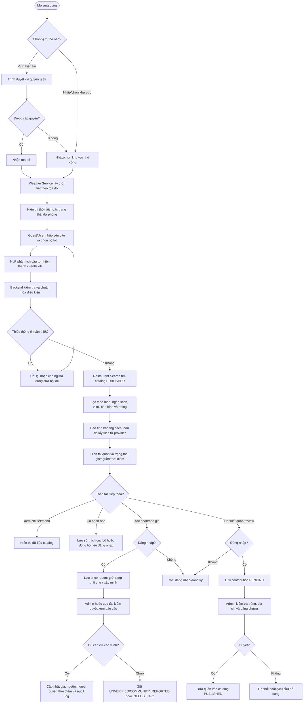

# Đặc tả Use Case — Mua Gì Đây

**Phiên bản:** cập nhật theo định hướng OSM, giá cộng đồng và cá nhân hóa không bắt buộc tài khoản  
**Phạm vi:** ứng dụng web tìm quán ăn theo món, vị trí, bán kính, ngân sách và đánh giá; cho phép đóng góp dữ liệu quán/giá để admin kiểm duyệt.

## 1. Mục tiêu và nguyên tắc

1. Khách có thể tìm kiếm, xem quán và dùng cá nhân hóa cơ bản mà không cần đăng nhập.
2. OSM là nguồn dữ liệu bản đồ mở, không phải một API duy nhất thay thế toàn bộ Google Maps. Ứng dụng chọn riêng nhà cung cấp bản đồ nền, geocoding và routing; có thể thay nhà cung cấp mà không đổi quy tắc nghiệp vụ.
3. Catalog quán và giá của Mua Gì Đây là nguồn dữ liệu hiển thị chính. OSM có thể hỗ trợ vị trí/địa điểm nhưng không đảm bảo có menu hoặc giá.
4. Giá mẫu/giá cộng đồng luôn phải hiển thị đúng trạng thái, nguồn và thời điểm. Một lượt xác nhận của khách không tự biến giá thành “đã xác minh”.
5. Tìm kiếm không bắt buộc AI. NLP/AI chỉ diễn giải câu tự nhiên thành bộ lọc có cấu trúc; backend kiểm tra dữ liệu và Restaurant Search Service mới quyết định kết quả.
6. Đăng nhập là tùy chọn cho trải nghiệm thông thường; yêu cầu tài khoản cho các đóng góp có trách nhiệm như review, đề xuất quán và báo cáo giá chính thức.

## 2. Quy ước actor và ba nhóm actor

- **Primary actor (tác nhân chính):** người hoặc vai trò khởi tạo use case để đạt mục tiêu.
- **Supporting actor (tác nhân hỗ trợ):** hệ thống, dịch vụ hoặc vai trò hỗ trợ hoàn tất luồng.
- **Offstage actor (tác nhân liên quan):** có lợi ích hoặc chịu tác động từ kết quả nhưng không trực tiếp thao tác trong luồng đó.
- Vai trò phụ thuộc từng use case: Admin có thể là primary actor khi duyệt quán, nhưng là offstage actor khi khách gửi báo cáo.

## 3. Danh sách tác nhân

| Actor | Loại | Trách nhiệm |
|---|---|---|
| Khách (Guest) | Người dùng | Tìm quán, xem kết quả/bản đồ, chọn vị trí và lưu sở thích cục bộ không cần tài khoản. |
| Người dùng có tài khoản (User) | Người dùng | Các quyền của Guest; đồng bộ sở thích/yêu thích và gửi review, báo cáo giá hoặc đề xuất quán. |
| Admin | Người dùng vận hành | Kiểm duyệt quán mới, xử lý báo cáo, xác minh và cập nhật catalog. Tài khoản do hệ thống cấp. |
| Trình duyệt Geolocation API | Hệ thống ngoài | Xin quyền và trả tọa độ thiết bị khi người dùng đồng ý. |
| Nhà cung cấp bản đồ OSM-derived | Hệ thống ngoài | Cung cấp map tiles/lớp bản đồ theo giấy phép và chính sách của nhà cung cấp. |
| Dịch vụ geocoding | Hệ thống ngoài | Chuyển địa chỉ thành tọa độ hoặc tọa độ thành địa chỉ; có thể là Nominatim hoặc nhà cung cấp khác. |
| Dịch vụ routing | Hệ thống ngoài | Tính tuyến đường/thời gian di chuyển nếu sản phẩm bật chức năng này. |
| WeatherAPI | Hệ thống ngoài | Cung cấp thời tiết theo tọa độ/khu vực. |
| Gemini API (tùy chọn) | Hệ thống ngoài | Hỗ trợ phân tích câu tìm kiếm tự nhiên thành intent/slots có cấu trúc; không tự xác minh hoặc sinh quán. |
| Dịch vụ nền SOA | Hệ thống | API Gateway và các service NLP, context/weather, restaurant/catalog, geo, review/contribution, auth và preference. |

> Google Maps có thể được mở như ứng dụng ngoài để chỉ đường nếu sản phẩm chọn vậy; điều đó không biến Google Places thành nguồn dữ liệu bắt buộc của tìm kiếm trong app.

## 4. Sơ đồ hoạt động tổng quát

### Ranh giới tin cậy

- Backend phải kiểm tra quyền Admin; frontend không tự quyết định quyền truy cập.
- Nội dung do NLP/Gemini trả về phải qua schema validation, giới hạn giá trị và kiểm tra nghiệp vụ.
- Kết quả từ OSM hoặc provider ngoài chỉ là dữ liệu tham khảo vị trí; app không được coi đó là menu/giá đã xác thực.
- Contribution của người dùng không tự sửa giá chính thức và không tự đưa quán mới lên public search.
- Mọi quyết định duyệt, xác minh, từ chối cần có người thực hiện, thời điểm, nguồn/bằng chứng và audit log.

## 5. Danh mục Use Case

| ID | Use Case | Primary actor | Cần đăng nhập? |
|---|---|---|---|
| UC-01 | Tạo tài khoản/đăng nhập | Guest/User | Có cho thao tác tài khoản |
| UC-02 | Chọn vị trí tìm kiếm | Guest/User | Không |
| UC-03 | Xem thời tiết và gợi ý món | Guest/User | Không |
| UC-04 | Tìm quán theo câu tự nhiên và bộ lọc | Guest/User | Không |
| UC-05 | Điều chỉnh và sắp xếp kết quả | Guest/User | Không |
| UC-06 | Xem quán, menu, trạng thái giá và mở chỉ đường | Guest/User | Không |
| UC-07 | Cá nhân hóa sở thích và yêu thích | Guest/User hoặc User | Không cho lưu cục bộ; có cho đồng bộ |
| UC-08 | Gửi xác nhận/báo cáo giá | User | Có |
| UC-09 | Gửi đánh giá quán | User | Có |
| UC-10 | Đề xuất quán mới hoặc báo sai thông tin | User | Có |
| UC-11 | Kiểm duyệt đề xuất quán | Admin | Có, quyền Admin |
| UC-12 | Xử lý báo cáo và xác minh giá/thông tin | Admin | Có, quyền Admin |

## 6. Đặc tả Use Case

### UC-01 — Tạo tài khoản/đăng nhập

| Thuộc tính | Đặc tả |
|---|---|
| Mục tiêu | Tạo danh tính để đồng bộ dữ liệu giữa thiết bị và thực hiện đóng góp có trách nhiệm. Tìm kiếm và sở thích cơ bản vẫn dùng được khi chưa đăng nhập. |
| Primary actor | Guest khi đăng ký; User khi đăng nhập. |
| Supporting actors | Frontend, API Gateway, Auth Service, kho tài khoản, dịch vụ email/OTP nếu triển khai. |
| Offstage actors | Admin; người dùng khác chịu ảnh hưởng từ đóng góp. |
| Tiền điều kiện | Đăng ký: thông tin hợp lệ và chưa có tài khoản. Đăng nhập: tài khoản tồn tại, không bị khóa. |
| Kích hoạt | Chọn đăng ký/đăng nhập hoặc chọn một thao tác yêu cầu tài khoản. |
| Luồng chính | 1) Nhập thông tin. 2) Backend xác thực đầu vào. 3) Khi đăng ký, lưu mật khẩu đã hash. 4) Cấp phiên/token và trả trạng thái. 5) Nếu có sở thích cục bộ, hỏi/cho phép nhập vào tài khoản để đồng bộ. |
| Ngoại lệ | Thông tin sai, email trùng, sai mật khẩu hoặc tài khoản bị khóa: báo lỗi và không tạo phiên. |
| Hậu điều kiện | Thành công: có phiên hợp lệ. Không đăng nhập: người dùng vẫn có thể tiếp tục các chức năng công khai. |

### UC-02 — Chọn vị trí tìm kiếm

| Thuộc tính | Đặc tả |
|---|---|
| Mục tiêu | Đặt tâm tìm kiếm cho khoảng cách, bản đồ và thời tiết. |
| Primary actor | Guest hoặc User. |
| Supporting actors | Trình duyệt Geolocation API, Frontend, API Gateway, Geo Service, geocoding provider, Weather Service. |
| Offstage actors | Người đi cùng; quán nằm trong khu vực được tìm. |
| Tiền điều kiện | Người dùng chọn dùng GPS hoặc nhập/chọn vị trí thủ công. |
| Kích hoạt | Chọn “Vị trí hiện tại” hoặc nhập địa chỉ/khu vực. |
| Luồng chính | 1) Nếu dùng GPS, trình duyệt xin quyền. 2) Khi được cấp, frontend nhận tọa độ. 3) Nếu nhập địa chỉ, Geo Service gọi geocoding provider. 4) Lưu vị trí trong trạng thái tìm kiếm hiện tại. 5) Hiển thị khu vực đang dùng và cho phép đổi. |
| Ngoại lệ | Từ chối quyền, timeout, địa chỉ không tìm thấy hoặc provider lỗi: cho nhập/chọn lại và không chặn tìm kiếm. |
| Hậu điều kiện | Tọa độ/khu vực được dùng cho truy vấn hiện tại; không lưu vị trí chính xác lâu dài nếu chưa có mục đích và lựa chọn rõ ràng. |

### UC-03 — Xem thời tiết và gợi ý món

| Thuộc tính | Đặc tả |
|---|---|
| Mục tiêu | Cho ngữ cảnh thời tiết hiện tại và gợi ý món theo thời tiết/thời gian. |
| Primary actor | Guest hoặc User. |
| Supporting actors | Frontend, API Gateway, Context-Weather Service, WeatherAPI. |
| Offstage actors | Quán có món được gợi ý. |
| Tiền điều kiện | Có vị trí do người dùng chọn hoặc vị trí mặc định của ứng dụng. |
| Kích hoạt | Mở trang chính hoặc đổi vị trí. |
| Luồng chính | 1) Frontend yêu cầu context. 2) Weather Service gọi provider bằng tọa độ/khu vực. 3) Chuẩn hóa nhiệt độ, điều kiện và thời điểm cập nhật. 4) Trả gợi ý món phù hợp. |
| Ngoại lệ | Provider lỗi/thiếu dữ liệu: hiển thị thời tiết không khả dụng hoặc cache có dấu thời gian; không trình bày dữ liệu cũ như thời tiết trực tiếp. |
| Hậu điều kiện | Ngữ cảnh được hiển thị cùng nguồn/thời điểm thích hợp. |

### UC-04 — Tìm quán theo câu tự nhiên và bộ lọc

| Thuộc tính | Đặc tả |
|---|---|
| Mục tiêu | Tìm quán phù hợp với món, mức giá, vị trí và bán kính. |
| Primary actor | Guest hoặc User. |
| Supporting actors | Frontend, API Gateway, NLP Service, Gemini API tùy chọn, Restaurant Search/Catalog Service, Geo Service. |
| Offstage actors | Quán có thể xuất hiện trong kết quả; người dùng khác. |
| Tiền điều kiện | Có truy vấn và vị trí tìm kiếm (GPS hoặc địa chỉ/khu vực). |
| Kích hoạt | Nhập yêu cầu, ví dụ “cơm dưới 40k gần đây”, rồi chọn Tìm quán. |
| Luồng chính | 1) NLP phân tích truy vấn bằng parser luật; gọi Gemini khi cần. 2) Tạo intent/slots như món, giá tối đa, bán kính và từ khóa. 3) Backend xác thực và chuẩn hóa. 4) Search Service truy vấn quán `PUBLISHED` và áp bộ lọc. 5) Trả kết quả cùng trạng thái/nguồn giá, khoảng cách và phân trang. |
| Ngoại lệ | Không hiểu truy vấn hoặc thiếu vị trí: hỏi người dùng bổ sung/sửa. Không có kết quả: gợi ý nới bộ lọc. AI/provider lỗi: cho sửa điều kiện hoặc tìm theo bộ lọc thủ công. |
| Hậu điều kiện | Chỉ quán đủ điều kiện công khai xuất hiện; dữ liệu giá giữ nguyên nhãn xác minh. |

### UC-05 — Điều chỉnh và sắp xếp kết quả

| Thuộc tính | Đặc tả |
|---|---|
| Mục tiêu | Thu hẹp kết quả theo khoảng cách, ngân sách, rating hoặc lựa chọn như gần nhất/rẻ nhất/đề xuất. |
| Primary actor | Guest hoặc User. |
| Supporting actors | Frontend, API Gateway, Restaurant Search Service, Geo Service, Review Service. |
| Offstage actors | Quán trong tập kết quả. |
| Tiền điều kiện | Có kết quả tìm kiếm hoặc điều kiện tìm kiếm hiện tại. |
| Kích hoạt | Chọn chip/bộ lọc hoặc nhập yêu cầu điều chỉnh như “gần hơn”. |
| Luồng chính | 1) Cập nhật tiêu chí. 2) Backend kiểm tra miền giá trị. 3) Search Service áp bộ lọc/sắp xếp. 4) Trả kết quả và số lượng phù hợp. |
| Ngoại lệ | Bán kính/giá không hợp lệ: yêu cầu chọn lại. Không có kết quả sau lọc: cho bỏ bớt điều kiện. |
| Hậu điều kiện | Bộ lọc mới áp dụng cho phiên tìm kiếm; Guest không cần đăng nhập. |

### UC-06 — Xem quán, menu, trạng thái giá và mở chỉ đường

| Thuộc tính | Đặc tả |
|---|---|
| Mục tiêu | Giúp người dùng đánh giá quán dựa trên thông tin có nguồn và xem đường đi. |
| Primary actor | Guest hoặc User. |
| Supporting actors | Frontend, Catalog Service, Review Service, bản đồ nền OSM-derived provider, routing provider hoặc ứng dụng bản đồ ngoài. |
| Offstage actors | Chủ quán; người đã đóng góp menu/giá. |
| Tiền điều kiện | Quán tồn tại và được phép hiển thị công khai. |
| Kích hoạt | Mở thẻ/chi tiết quán hoặc chọn “Chỉ đường”. |
| Luồng chính | 1) Hiển thị tên, địa chỉ, món/menu, khoảng cách, rating và nguồn dữ liệu. 2) Giá hiển thị là giá đã xác minh, giá tham khảo/chưa xác minh, giá cộng đồng báo cáo hoặc “chưa có giá”. 3) Chọn chỉ đường sẽ mở routing/app bản đồ đã cấu hình. 4) Bản đồ ghi công OSM/provider theo điều khoản. |
| Ngoại lệ | Không có menu/giá: ghi rõ “Chưa có giá” và không suy diễn. Routing/map provider lỗi: vẫn hiển thị địa chỉ để người dùng tự tra cứu. |
| Hậu điều kiện | Không thay đổi dữ liệu quán khi chỉ xem hoặc mở chỉ đường. |

### UC-07 — Cá nhân hóa sở thích và yêu thích

| Thuộc tính | Đặc tả |
|---|---|
| Mục tiêu | Lưu món thích, món cần tránh, chế độ ăn, phương tiện/ưu tiên và quán yêu thích. |
| Primary actor | Guest với lưu cục bộ; User với đồng bộ tài khoản. |
| Supporting actors | Frontend, localStorage/IndexedDB của trình duyệt; Preference Service và kho dữ liệu người dùng nếu đăng nhập. |
| Offstage actors | Quán được ưu tiên hoặc loại khỏi gợi ý. |
| Tiền điều kiện | Người dùng mở phần cá nhân hóa. Đăng nhập chỉ cần cho đồng bộ máy chủ. |
| Kích hoạt | Chọn/lưu sở thích hoặc đánh dấu yêu thích. |
| Luồng chính | 1) Người dùng chọn các tùy chọn. 2) Guest lưu trên trình duyệt hiện tại và thấy thông báo “Chỉ lưu trên thiết bị này”. 3) User có thể lưu cục bộ và đồng bộ server. 4) Gợi ý sau đó áp dụng sở thích đã lưu. 5) Khi Guest đăng nhập, có thể chọn nhập sở thích cục bộ vào tài khoản. |
| Ngoại lệ | Storage bị chặn/xóa hoặc trình duyệt ở chế độ riêng tư: báo rằng tùy chọn không lưu được, vẫn cho dùng trong phiên hiện tại. Lỗi đồng bộ: giữ bản cục bộ và báo trạng thái. |
| Hậu điều kiện | Guest: dữ liệu chỉ nằm trong storage của trình duyệt trên thiết bị đó, không đảm bảo tồn tại vĩnh viễn hay đồng bộ thiết bị. User: dữ liệu đồng bộ theo chính sách tài khoản. |

### UC-08 — Gửi xác nhận/báo cáo giá

| Thuộc tính | Đặc tả |
|---|---|
| Mục tiêu | Thu thập thông tin thực tế về giá món để cải thiện độ tin cậy của catalog. |
| Primary actor | User đã đăng nhập. |
| Supporting actors | Frontend, API Gateway, Contribution/Price Service, kho dữ liệu báo cáo, moderation/anti-spam. |
| Offstage actors | Admin, chủ quán và người xem giá. |
| Tiền điều kiện | Quán tồn tại; người dùng đã đăng nhập; báo cáo gắn với món/quán và có dữ liệu cần thiết. |
| Kích hoạt | Chọn “Giá không đúng”, “Giá vẫn đúng” hoặc gửi giá/ảnh menu mới. |
| Luồng chính | 1) Chọn món và loại xác nhận. 2) Nếu báo giá mới, nhập giá quan sát, ngày quan sát và bằng chứng tùy chọn. 3) Backend kiểm tra dữ liệu, giới hạn tần suất và lưu `PriceReport`. 4) Trả trạng thái tiếp nhận. 5) Tổng hợp báo cáo cộng đồng mà không tự gắn nhãn admin-verified. |
| Ngoại lệ | Chưa đăng nhập: yêu cầu đăng nhập trước khi gửi. Thiếu/không hợp lệ hoặc nghi spam: yêu cầu sửa hoặc từ chối. |
| Hậu điều kiện | Báo cáo được lưu với người gửi, thời điểm, giá trị/bằng chứng và trạng thái như `PENDING` hoặc `COMMUNITY_REPORTED`; giá chính thức không tự đổi. |

### UC-09 — Gửi đánh giá quán

| Thuộc tính | Đặc tả |
|---|---|
| Mục tiêu | Cho người dùng đánh giá trải nghiệm và cung cấp nhận xét hữu ích. |
| Primary actor | User đã đăng nhập. |
| Supporting actors | Frontend, API Gateway, Review Service, moderation/anti-spam. |
| Offstage actors | Chủ quán, người đọc review, Admin. |
| Tiền điều kiện | Quán đang công khai; User đăng nhập. |
| Kích hoạt | Gửi rating và nội dung đánh giá. |
| Luồng chính | 1) Nhập rating/comment. 2) Backend kiểm tra phạm vi, độ dài, spam và quy tắc nội dung. 3) Lưu review theo trạng thái kiểm duyệt phù hợp. 4) Hiển thị hoặc xếp hàng kiểm duyệt theo chính sách. |
| Ngoại lệ | Dữ liệu sai, trùng lặp hoặc vi phạm quy tắc: từ chối hoặc giữ chờ xử lý. |
| Hậu điều kiện | Review được truy vết; rating không tự xác minh giá hoặc thông tin quán. |

### UC-10 — Đề xuất quán mới hoặc báo sai thông tin

| Thuộc tính | Đặc tả |
|---|---|
| Mục tiêu | Cho người dùng đề xuất quán chưa có hoặc báo sai địa chỉ, menu, giá, trạng thái hoạt động. |
| Primary actor | User đã đăng nhập. |
| Supporting actors | Frontend, API Gateway, Contribution/Catalog Service, Geo/geocoding provider, kho submission và file bằng chứng. |
| Offstage actors | Admin, chủ quán, người dùng khác. |
| Tiền điều kiện | User đăng nhập; đề xuất có thông tin tối thiểu; báo cáo sai thông tin tham chiếu quán hiện có. |
| Kích hoạt | Chọn “Thêm quán” hoặc thao tác báo cáo trên thẻ/chi tiết quán. |
| Luồng chính | 1) Nhập thông tin, vị trí và loại đóng góp. 2) Có thể gửi giá tham khảo nhưng phải đánh dấu chưa xác minh. 3) Backend kiểm tra dữ liệu/trùng lặp và lưu submission `PENDING`. 4) Trả mã và trạng thái cho người gửi. 5) Không làm thay đổi catalog công khai trước khi duyệt. |
| Ngoại lệ | Thiếu dữ liệu/trùng nghi vấn: yêu cầu bổ sung hoặc liên kết bản ghi hiện có. Upload lỗi: thông báo và cho gửi lại. |
| Hậu điều kiện | Submission có người gửi, timestamp, bằng chứng, loại yêu cầu và trạng thái kiểm duyệt. |

### UC-11 — Kiểm duyệt đề xuất quán

| Thuộc tính | Đặc tả |
|---|---|
| Mục tiêu | Quyết định quán mới có đủ căn cứ để công khai hay cần bổ sung/từ chối. |
| Primary actor | Admin có quyền moderation. |
| Supporting actors | Admin UI, API Gateway, Identity/Authorization, Catalog Service, Geo/provider tham khảo, audit log, notification service. |
| Offstage actors | Người gửi, chủ quán, người tìm kiếm. |
| Tiền điều kiện | Admin có quyền; submission ở trạng thái `PENDING` hoặc `NEEDS_INFO`. |
| Kích hoạt | Admin mở hàng chờ kiểm duyệt. |
| Luồng chính | 1) Xem thông tin, bằng chứng và khả năng trùng. 2) Kiểm tra tên, địa chỉ/tọa độ, loại quán và nguồn. 3) Chọn duyệt, yêu cầu bổ sung hoặc từ chối. 4) Backend kiểm tra quyền và trạng thái. 5) Ghi quyết định/người duyệt/thời gian vào audit log. 6) Chỉ khi duyệt mới tạo/cập nhật quán `PUBLISHED`. 7) Thông báo người gửi. |
| Ngoại lệ | Thiếu căn cứ: chuyển `NEEDS_INFO`; đã được xử lý: không ghi đè; không đủ quyền: trả 403. |
| Hậu điều kiện | Quán chỉ xuất hiện trong public search sau khi duyệt thành công. |

### UC-12 — Xử lý báo cáo và xác minh giá/thông tin

| Thuộc tính | Đặc tả |
|---|---|
| Mục tiêu | Kiểm tra báo cáo cộng đồng và quyết định cập nhật giá/menu/thông tin chính thức. |
| Primary actor | Admin có quyền quản lý catalog. |
| Supporting actors | Admin UI, API Gateway, Catalog/Price Service, Contribution Service, audit log, bằng chứng từ người dùng/nguồn chính thức. |
| Offstage actors | Người báo cáo, chủ quán, người dùng xem dữ liệu. |
| Tiền điều kiện | Quán/món tồn tại; có báo cáo hoặc yêu cầu cập nhật; Admin có quyền. |
| Kích hoạt | Admin mở hàng đợi báo cáo giá/thông tin. |
| Luồng chính | 1) Xem giá hiện tại, trạng thái, lịch sử báo cáo và bằng chứng. 2) Đánh giá nguồn và thời điểm. 3) Cập nhật hoặc giữ nguyên dữ liệu. 4) Khi đủ căn cứ, ghi giá, `verifiedBy`, `verifiedAt`, `verificationSource` và trạng thái `ADMIN_VERIFIED`. 5) Nếu chỉ có nhiều xác nhận cộng đồng, có thể gắn `COMMUNITY_REPORTED` theo chính sách nhưng không gọi là admin-verified. 6) Ghi audit log và thông báo khi phù hợp. |
| Ngoại lệ | Bằng chứng yếu/mâu thuẫn: giữ `UNVERIFIED` hoặc `NEEDS_INFO`; xung đột cập nhật: tải lại trước khi lưu; không có quyền: trả 403. |
| Hậu điều kiện | Mọi thay đổi giá có thể truy xuất lịch sử, nguồn và thời điểm; nhãn hiển thị đúng trạng thái xác minh. |

## 7. Trạng thái dữ liệu đề xuất

### Trạng thái quán

`PENDING` → `PUBLISHED` hoặc `REJECTED`; có thể dùng `NEEDS_INFO` khi cần người gửi bổ sung. Chỉ `PUBLISHED` được đưa vào tìm kiếm công khai.

### Trạng thái giá

| Trạng thái | Ý nghĩa hiển thị |
|---|---|
| `NO_PRICE` | Chưa có dữ liệu giá; hiển thị “Chưa có giá”. |
| `UNVERIFIED` | Giá tham khảo do app/người đóng góp cung cấp, chưa được kiểm chứng; ghi nguồn và thời điểm nếu có. |
| `COMMUNITY_REPORTED` | Có phản hồi từ cộng đồng; hiển thị số lượng/thời điểm nếu đạt ngưỡng, không gọi là admin xác minh. |
| `ADMIN_VERIFIED` | Admin đã kiểm tra theo nguồn/bằng chứng; hiển thị ngày xác minh và nguồn phù hợp. |
| `STALE` | Dữ liệu đã quá hạn theo chính sách freshness; cần xác nhận lại. |

Mỗi món/quãng giá nên lưu tối thiểu: `minPrice`, `maxPrice`, `currency`, `status`, `source`, `observedAt`, `verifiedAt`, `verifiedBy` (nếu có), và lịch sử báo cáo. Giá mẫu như 30–35k chỉ được gắn cho món/quán khi có cơ sở dữ liệu hoặc quy tắc gợi ý minh bạch; không được trình bày như giá thực tế đã kiểm tra.

## 8. Quy tắc nghiệp vụ xuyên use case

| Mã | Quy tắc |
|---|---|
| BR-01 | Tìm kiếm, xem quán, xem bản đồ và cá nhân hóa cục bộ không bắt buộc đăng nhập. |
| BR-02 | Sở thích Guest được lưu trong storage của trình duyệt trên thiết bị hiện tại; không bảo đảm tồn tại vĩnh viễn, không đồng bộ thiết bị và có thể mất khi người dùng xóa dữ liệu/trình duyệt dọn dữ liệu. |
| BR-03 | Đăng nhập dùng để đồng bộ sở thích/yêu thích và gửi đóng góp có danh tính. Không ép đăng nhập chỉ để tìm kiếm. |
| BR-04 | Chỉ Admin được duyệt quán hoặc gắn `ADMIN_VERIFIED`; mọi quyền được kiểm tra ở backend. |
| BR-05 | Quán `PENDING`, `NEEDS_INFO` hoặc `REJECTED` không xuất hiện như quán công khai. |
| BR-06 | Không suy diễn giá từ dữ liệu bản đồ. Giá phải có nguồn trong catalog/menu hoặc báo cáo giá được lưu riêng. |
| BR-07 | Một lượt xác nhận giá không tự làm thay đổi giá chính thức hoặc trạng thái `ADMIN_VERIFIED`. |
| BR-08 | Luôn phân biệt giá chưa xác minh, báo cáo cộng đồng, đã xác minh và chưa có giá. |
| BR-09 | OSM data cần ghi công theo giấy phép; tile/geocoding/routing provider có chính sách, giới hạn và SLA riêng. Không coi máy chủ công cộng là dịch vụ miễn phí không giới hạn. |
| BR-10 | Không gọi public Nominatim cho autocomplete hoặc tải hàng loạt; dùng provider phù hợp, cache và tuân thủ chính sách dịch vụ được chọn. |
| BR-11 | NLP/Gemini chỉ trích xuất intent/slots; backend xác thực, Search Service truy vấn catalog. AI không tự tạo quán hoặc xác minh giá. |
| BR-12 | Từ chối quyền vị trí không chặn tìm kiếm; người dùng có thể nhập/chọn địa điểm thủ công. |
| BR-13 | Contribution, moderation và thay đổi xác minh phải có audit trail, bao gồm tác nhân, thời điểm, trạng thái trước/sau và nguồn/bằng chứng. |

## 9. Ngoài phạm vi và ghi chú triển khai

- Tài liệu mô tả hành vi mong muốn, không khẳng định mọi service, provider OSM, Auth, Gemini, moderation, Prometheus hay Grafana đã được triển khai.
- OSM được dùng như nguồn dữ liệu bản đồ mở; cần quyết định riêng provider tiles, geocoding và routing dựa trên lưu lượng, giới hạn, chi phí, giấy phép và SLA.
- Định dạng và ngưỡng “giá cộng đồng đủ tin cậy” cần được chốt bằng chính sách sản phẩm trước khi tự động thay đổi nhãn hiển thị.
- Tài khoản Admin được tạo/cấp quyền nội bộ; không có luồng tự đăng ký Admin công khai.
- Dữ liệu vị trí chính xác và ảnh menu cần có mục đích sử dụng, quyền truy cập và thời hạn lưu phù hợp.
